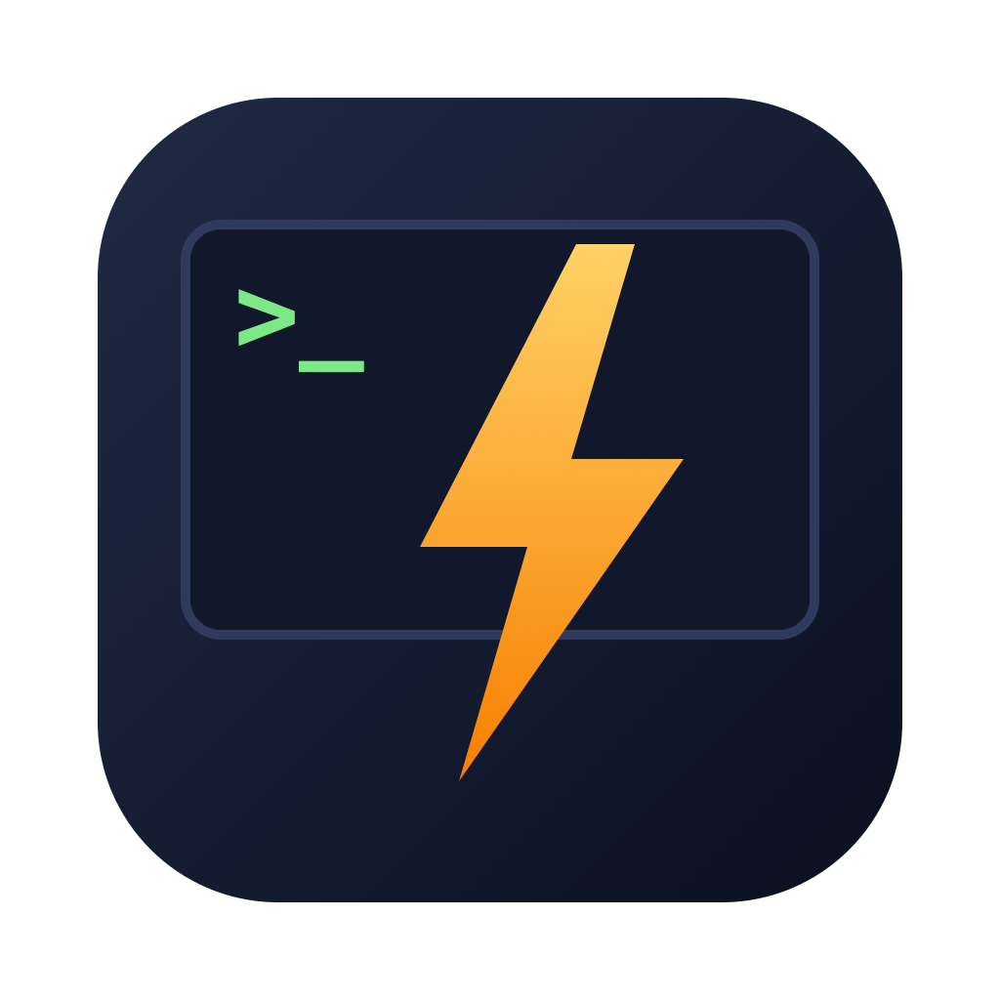

<p align="center">
  
</p>

# Speedy

Speedy is a fast, native Mac app for running several Claude Code agents at once, across as many project folders as you like. Each thread gets a chat panel that looks and behaves like the Claude Code VS Code extension, with real terminals docked below it.

Speedy drives the `claude` CLI you already have installed, under your own login. Your settings, MCP servers, hooks, skills, and session history carry over unchanged, and Speedy never reads or stores your credentials.

## Why

The VS Code extension is a good place to talk to Claude, but running five agents in parallel there means five editor tabs, five terminals, and a lot of window juggling. Speedy keeps each conversation in its own thread, tells you when a hidden one needs you, and launches in well under a second.

## Features

- **Parallel threads.** Group projects in the sidebar and run a thread per task. Threads that finish or ask for permission while hidden are flagged in the sidebar and on the Dock badge, and post a notification.
- **Familiar chat.** Same colors, fonts, tool cards, thinking rows, todo list, and permission cards as the VS Code extension, in light and dark.
- **Composer.** `/` command menu (plugin commands match by short name, so `/ce-plan` finds `/compound-engineering:ce-plan`), `@` file mentions, pasted images, queued messages, Esc to interrupt, Shift+Tab to cycle permission modes, plus model and effort pickers. The footer shows how much of the context window is used; click it for a breakdown and to compact.
- **Permissions.** Inline cards for edits (with diffs), Bash, plan approval, and questions. "Always allow" names the settings file the rule is saved to.
- **Terminals.** A real PTY per thread with multiple tabs, WebGL rendering, search, and links. Select output and press Cmd+L to attach it to your next message. Shells are killed when you quit.
- **History.** Browse and resume sessions started in VS Code or the CLI, rename them, and fork a conversation with its code rewound to an earlier turn.
- **Worktrees.** Optionally start a thread on its own branch in a separate git worktree, so parallel agents don't step on each other's files.
- **File explorer** and a `speedy .` shell command, like VS Code's `code .`. File references in Claude's replies (`src/app.ts:42`) open in the explorer at that line.

## Requirements

- macOS 13 or later
- The [Claude Code CLI](https://docs.anthropic.com/en/docs/claude-code), installed and logged in (`claude` works in your terminal)
- To build: [Rust](https://rustup.rs), [Bun](https://bun.sh), and the Xcode Command Line Tools

## Install

There are no prebuilt releases yet, so build it from source:

```sh
git clone https://github.com/xanojustin/speedy.git
cd speedy
./scripts/reinstall.sh
```

The script installs dependencies, builds `Speedy.app` (ad-hoc signed), quits any running copy, installs it to `/Applications`, and opens it. Run it again to update after pulling. Pass `--no-open` to skip launching.

To do it by hand:

```sh
bun install
bun run tauri build
cp -R src-tauri/target/release/bundle/macos/Speedy.app /Applications/
```

On first launch Speedy finds `claude` through your login shell, so CLIs installed with nvm, Homebrew, or similar work even when the app is opened from the Dock. If the CLI is missing or logged out, the setup screen tells you what to do.

### The `speedy` command

Choose **Speedy > Install 'speedy' Command in PATH…** once. After that, `speedy .` (or `speedy ~/a ~/b`) adds each folder as a project, or selects it if it's already open. It works whether or not Speedy is running.

## Keyboard shortcuts

| Shortcut | Action |
|---|---|
| Cmd+N | New thread |
| Cmd+W | Close thread (archives it; asks first if it's working) |
| Cmd+O | Add project folder |
| Cmd+1 … Cmd+9 | Switch to thread 1–9 |
| Cmd+L | Focus chat (in the terminal with a selection: attach it to the chat) |
| Cmd+J | Toggle terminal |
| Cmd+Shift+J | Maximize terminal |
| Ctrl+Shift+` | New terminal tab |
| Cmd+Shift+E | Toggle file explorer |
| Cmd+, | Settings |

In the composer: Enter sends, Shift+Enter (or Ctrl+J) adds a newline, Esc interrupts, and Shift+Tab cycles permission modes.

## Worktrees

Before a thread's first message, the composer footer has a **Worktree** toggle. When it's on, the first message puts the thread on a new `speedy/<thread-id>` branch, created from the project's `HEAD`, in its own worktree under `~/Library/Application Support/Speedy/worktrees/`. Rename the branch whenever you like with `git branch -m`.

A few things to know:

- The choice is locked after the first message. Forks keep their thread's worktree.
- Speedy never deletes worktrees (archived threads can be restored), so clean them up with `git worktree remove`.
- Gitignored files such as `.env` and `node_modules` aren't copied into a new worktree.
- Sessions from worktree threads don't show up in the project's history list, because the CLI files them under the worktree's path.

## Known limitations

- Effort can only be changed during a live session, and isn't saved per thread.
- You can paste images into the composer, but not drag image files onto it.
- "Fork conversation" always opens the fork in a new thread.
- If you relaunch before sending the first message in a forked thread, that thread opens blank. The original thread is unaffected.
- Notifications only work from the bundled app, not under `tauri dev`.

## Development

```sh
bun install
bun run tauri dev
```

| Check | Command |
|---|---|
| UI tests | `bun run test` |
| Typecheck | `bun run typecheck` |
| Rust tests | `cargo test --manifest-path src-tauri/Cargo.toml --workspace` |
| Rust lint | `cargo clippy --manifest-path src-tauri/Cargo.toml --workspace --all-targets -- -D warnings` |
| Protocol drift (real CLI, denies every tool, uses Haiku) | `cargo test --manifest-path src-tauri/Cargo.toml -p speedy-core --test claude_actor_test -- --ignored` |
| Regenerate theme tokens | `bun scripts/gen-vscode-theme.ts` |

Speedy talks to the CLI over its stream-json protocol, which can change between CLI releases. When the setup screen warns that your CLI version differs from the last one tested, run the protocol drift test.

### Layout

- `src-tauri/src/`: the Rust core
  - `claude/`: one CLI process per thread, the stream-json protocol, and permission diffs
  - `pty/`: terminal shells
  - `state/`: app state and the CLI session index
  - `env.rs`: login-shell environment and CLI discovery
  - `files.rs`: `@` mention search
  - `attention.rs`: notifications and the Dock badge
  - `menu.rs`: native menu and shortcuts
  - `cli.rs`: the `speedy` command and folders opened from Finder or the Dock
- `src/`: the React webview
  - `app/`, `sidebar/`, `settings/`: shell, layout, and shortcuts
  - `chat/`, `composer/`, `permissions/`, `history/`, `terminal/`, `explorer/`
  - `store/`: thread store, reducer, and runtime bridge
  - `theme/`: `--vscode-*` tokens generated from VS Code's built-in themes

Performance notes are in [docs/perf.md](docs/perf.md), and the original design plan is in [docs/plans/](docs/plans/).

Speedy is an independent project and isn't affiliated with or endorsed by Anthropic.
