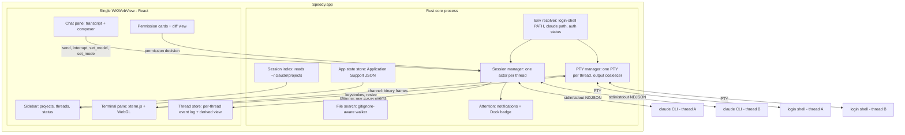
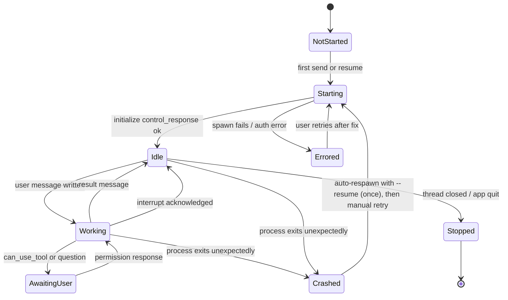
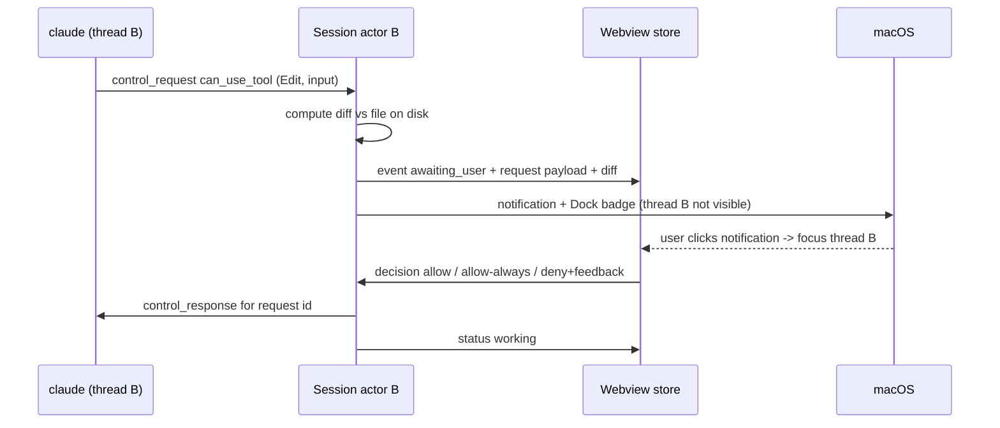

# Speedy Standalone Claude Code App - Plan

## Goal Capsule

- **Objective:** The user runs all their Claude Code work in one fast standalone Mac app: several agents in parallel across several project folders, each paired with its own terminal. The chat looks and behaves like the Claude Code VS Code panel, so VS Code no longer needs to be open.
- **Means:** A Tauri v2 app with a Rust core that owns one `claude` CLI process and one shell PTY per thread. A single React webview renders a pixel-faithful rebuild of the extension's panel (KTD1, KTD2, KTD3).
- **Authority:** User request > Product Contract R-IDs > KTDs > unit Approach text. An R wins on product behavior, and a KTD wins on mechanism.
- **Stop conditions:** Stop and re-plan if the U1 spike misses any gate in the Verification Contract. Stop if the CLI's stream-json control protocol cannot carry a parity feature that the CLI itself implements and R7–R12 require, and record which feature it was. Features the extension implements on the VS Code host side follow the Assumptions entry instead.
- **Execution profile:** Phased. U1 is a throwaway-quality spike that gates the rest. The units after U1 build production code.
- **Finishes and ships:** The user. It is a personal, unsigned or ad-hoc-signed local app with no distribution.

---

## Product Contract

### Summary

Build "Speedy", a native-feeling macOS app that replaces VS Code for the one job it still does for this user. Its left sidebar lists project folders and their threads. Each thread is a Claude Code session that runs independently, with a chat panel matching the VS Code extension and a real terminal docked below it. The app uses the user's installed `claude` CLI and existing login, so settings, MCP servers, hooks, and session history carry over unchanged.

### Problem Frame

The user keeps VS Code open only for two things: the Claude Code panel and the integrated terminal. VS Code costs startup time, memory, and visual clutter for features they don't use. It is also awkward for running several agents at once across projects, because each window holds one folder and the Claude panel and terminal are tied to the editor's layout. The user doesn't want new features. They want the exact extension experience, without the editor, and arranged for parallel work.

Anthropic's Claude Desktop app now has a Code tab with a multi-project sidebar, parallel sessions, and a terminal per session. Its chat UI isn't the VS Code panel, and the user can't tune its performance. Building Speedy makes sense only if the extension's exact look and feel, plus Mac-terminal fidelity, are worth owning a codebase. That trade-off is recorded under Key Decisions.

### Requirements

**App shell and projects**

- R1. Speedy is a standalone macOS app for Apple Silicon. It launches from the Dock or Finder and doesn't depend on VS Code being installed or running.
- R2. The sidebar lists project folders. The user can add a folder with a picker or by drag-and-drop, and can remove or reorder folders. The list persists across relaunches.
- R3. Each project holds any number of threads. The user can create, rename, and close threads, and closing a thread archives it rather than deleting its session.
- R4. Threads run fully in parallel. Switching the visible thread never pauses, throttles, or drops output from another thread's agent or terminal.
- R5. Every thread shows its live status in the sidebar: idle, working, waiting on the user (a permission request or question), finished-unread, or errored.
- R6. When a thread that isn't visible starts waiting on the user or finishes, Speedy raises a macOS notification and updates the Dock badge count. Clicking the notification opens that thread.

**Chat panel parity with the VS Code extension**

- R7. The chat panel reproduces the extension's visual design: VS Code Dark Modern and Light Modern colors following the system appearance, typography, spacing, codicon icons, message layout, and spinner verbs.
- R8. The transcript renders everything the extension renders: streamed assistant markdown with highlighted code blocks, thinking blocks, collapsible tool-call cards with results, subagent/task progress, the todo list, and errors.
- R9. The composer matches the extension: multiline input with its Enter/Shift+Enter (or Ctrl+Enter) send behavior, the slash-command menu, @-mention file search that respects `.gitignore`, image paste and drag, queued messages while the agent is working, and Esc to interrupt.
- R10. The model picker, permission-mode switcher (default, accept edits, plan, bypass when allowed), effort/thinking control, and context-usage indicator behave as they do in the extension.
- R11. Permission requests appear inline with the extension's allow-once, always-allow, and deny-with-feedback choices. Edit and Write requests show the proposed change as a diff the user accepts or rejects. Plan-mode exits show the plan for approval.
- R12. A per-project session history lists past conversations, including those started in the CLI or VS Code for the same folder. The user can resume, rename, and start new conversations, and rewind works where the extension supports it.
- R13. Speedy drives the user's installed `claude` CLI under the user's own login. It never reads, stores, or proxies Claude credentials, and if the CLI is missing or logged out it tells the user how to fix that.

**Terminal per thread**

- R14. Each thread owns exactly one terminal that starts the user's login shell in the project folder. Its process keeps running while other threads are visible.
- R15. The terminal behaves like a Mac terminal. That covers full-screen TUIs (vim, htop, less, Claude Code's own TUI), 256-color and truecolor, mouse reporting, Option as Meta, Cmd+C/V/K/F/A, clickable links, and a large scrollback.
- R16. The terminal docks below the chat in a resizable split that can be toggled and maximized, like VS Code's panel. The split position persists per thread.

**Performance**

- R17. Speedy is noticeably lighter than VS Code with the extension. The thresholds are in Success Criteria.

### Key Decisions

- **Rebuild the extension's UI to match it. Don't lift its compiled bundle.** The extension's webview is proprietary. Speedy uses the VS Code theme token names and the MIT-licensed codicons and re-implements the components. Governs R7, R8.
- **Build rather than adopt Claude Desktop's Code tab, Conductor, or Opcode.** None of them reproduces the VS Code panel, and the user prioritizes that panel plus terminal fidelity over the cost of maintaining their own app. Governs R7–R12.
- **macOS only, single user.** Cross-platform support, code signing for distribution, and auto-update are out. Governs R1.
- **Threads in one project share the folder.** Speedy adds no git worktree isolation, matching the extension's default. Governs R3, R4.
- **The product name avoids "Claude" and "Anthropic".** Anthropic's third-party policy restricts using its marks. Governs R1.

### Success Criteria

- Measurement state: 5 threads, each with one completed turn (so each `claude` process is alive) and a live shell. Compare on the same Mac against VS Code with the extension in the equivalent state, using 5 Claude tabs and 5 terminals.
- Cold launch to an interactive sidebar is faster than VS Code's cold launch to an interactive Claude panel, and under 1 second.
- Speedy's own processes (Rust plus WebKit) use less resident memory than VS Code's own processes (main, renderer, GPU, and extension host), and under 400 MB. CLI and shell child processes are excluded on both sides, and totals including them are recorded for reference.
- Running `cat` on a 50 MB log in a terminal while two other threads stream agent output keeps the UI responsive, with no dropped keystrokes and visible frame hitches under 100 ms.
- The user can work a full day without opening VS Code for chat or terminal work. This is the real acceptance signal.

### Scope Boundaries

- No code editor, file explorer, search panel, git UI, extension system, or settings UI beyond what the extension's panel itself offers.
- No features the extension lacks, such as worktree-per-thread, kanban views, or PR monitoring.
- No direct Anthropic API usage and no API-key mode. All model access goes through the user's `claude` CLI.
- Shell processes aren't restored across app relaunch. A relaunched thread gets a fresh shell in its folder, and the conversation resumes through the CLI's session.
- Considered and not built: a file-level lock or general conflict warning when two threads in one project edit the same file. The extension doesn't do this, and git status in the terminal shows it. The one case where a user could approve changes they never saw, a stale diff on a permission card, is handled by KTD5. Revisit if lost edits actually happen.
- Considered and not built: a Rust-side per-thread event log for rehydrating panes. The webview store already holds hidden threads' state (KTD2), and a reloaded webview rebuilds from the CLI's session JSONL (U11). Revisit if webview reloads become common.
- Considered and not built: guarding rewind against reverting another thread's edits to the same file. Rewind is user-initiated and its file list is shown before it runs. Revisit if it actually bites.
- Considered and not built: per-thread resource caps or agent throttling. Revisit if more than about 10 concurrent agents make the machine unresponsive.

#### Deferred to Follow-Up Work

- VS Code features the extension reaches into that need an editor: "open file at line" from tool cards opens the file in the user's default editor through `open`, not an in-app editor.
- Speech-to-text dictation (the extension bundles an audio-capture module) is deferred until core parity ships.
- Claude-in-Chrome and remote-control toggles from the extension's settings are deferred. They pass through to the CLI unchanged if configured there.

### Dependencies

- The user's `claude` CLI (2.1.296 at planning time), installed through nvm at a PATH that Finder-launched apps don't inherit (KTD7).
- A Rust toolchain via rustup. It isn't installed on this machine yet and is a prerequisite for U1. Bun is installed and serves as the JS package manager and runner.

### Sources

- Installed extension `anthropic.claude-code-2.1.299-darwin-arm64`:
  - Its host embeds the Agent SDK. The SDK spawns the CLI with `--output-format stream-json --verbose --input-format stream-json` and speaks a control protocol of `control_request` and `control_response` messages. Subtypes include `initialize`, `can_use_tool`, `interrupt`, `set_model`, `set_permission_mode`, `set_max_thinking_tokens`, `rewind_files`, `get_context_usage`, and `mcp_status`.
  - Its webview is React plus `marked`, styled with about 258 `--vscode-*` CSS variables.
  - Its diffs use VS Code's native diff editor through the `acceptProposedDiff` and `rejectProposedDiff` commands.
- code.claude.com/docs/en/desktop: Claude Desktop Code tab features (prior art).
- code.claude.com/docs/en/legal-and-compliance: an end user signing into the unmodified `claude` binary with their own subscription is allowed. Third parties must not offer Claude.ai login or handle subscription credentials.
- code.claude.com/docs/en/agent-sdk/streaming-vs-single-mode: the streaming-input mode Speedy uses.
- github.com/winfunc/opcode: the closest stack prior art (Tauri, Rust, React). It is AGPL per its README, so read it for patterns only and copy no code.

---

## Planning Contract

### Key Technical Decisions

- KTD1. **Tauri v2 with a Rust core and a single React/TypeScript webview.** The extension's panel is a React web UI, so a webview is the only realistic way to match it 1:1. Tauri uses the system WKWebView and a Rust process, avoiding Electron's bundled Chromium and Node. Rejected alternatives:
  - Native Swift/AppKit or a Rust GPU UI (GPUI, egui): leaner, but every chat component would be redrawn by hand and fidelity would drift.
  - Electron: higher memory per window for no fidelity gain.
- KTD2. **One webview for the whole app.** Every thread's chat and terminal is a DOM pane inside it, not a separate webview. Multiple WKWebViews multiply WebContent processes and memory. Inactive threads keep their state in the store, but their chat DOM is unmounted and their terminals detach from WebGL (KTD3).
- KTD3. **Terminals use xterm.js with `@xterm/addon-webgl`, backed by `portable-pty` in Rust.** This is the engine behind VS Code's terminal, which the user already likes.
  - Only visible terminals hold a WebGL context, because browsers cap the number of contexts. Hidden ones keep their xterm buffer and fall back to no renderer. A `webglcontextlost` event disposes the addon and falls back to the DOM renderer.
  - Rust coalesces PTY output into frames of about 8–16 ms and sends them as binary over Tauri channels, not JSON events per chunk.
  - Rejected: libghostty and `alacritty_terminal`. Neither has a stable embed or renderer that fits a webview.
- KTD4. **Speak the CLI's stream-json protocol directly from Rust, behind a thin, tolerant layer.**
  - Rust parses the envelope: message `type`, control request IDs and subtypes, and `session_id`. Every event goes to the UI as raw JSON, so new CLI fields reach the renderer without Rust changes.
  - Spawn contract, matching the extension's SDK:
    - Flags: `--output-format stream-json --verbose --input-format stream-json --include-partial-messages --permission-prompt-tool stdio`.
    - Optional flags, added when they apply: `--resume <id>`, `--model`, `--permission-mode`, and the thinking flags.
    - Environment: `CLAUDE_CODE_ENABLE_SDK_FILE_CHECKPOINTING=true`.
    - Without partial messages, text arrives as whole messages and there is no streaming. Without checkpointing, rewind fails.
  - The UI types events against the published `@anthropic-ai/claude-agent-sdk` TypeScript types, imported as types only.
  - The SDK source is the de facto spec. A recorded-fixture contract test catches drift (U3).
  - Rejected: a Node sidecar running the official TS SDK. It would track the protocol for free but adds a Node runtime to a performance-first app. Revisit if drift fixes cost more than about one day per month.
- KTD5. **Permissions go through the control channel.** The CLI is launched with the stdio permission-prompt mode so every `can_use_tool` request reaches the UI.
  - Always-allow returns the CLI's own suggested permission updates, so rules land in the user's normal Claude settings files. The card shows where the rule will be saved (project-local, project, or user), because a project rule auto-approves for every thread in that folder and for VS Code too.
  - For Edit, Write, and MultiEdit requests, the diff is computed from the tool input against the file on disk. A rejection with feedback returns a deny that carries the user's message.
  - A pending request never outlives its turn. Interrupting a thread denies its pending request first and then sends the interrupt. Quitting denies every pending request before shutdown (KTD9).
  - The diff is recomputed when the user acts on it. If the file changed since the diff was shown, typically because another thread in the same project wrote to it, the card refreshes and asks again instead of approving changes the user never saw.
- KTD6. **Speedy stores only its own app state. Transcripts stay with the CLI.**
  - Speedy writes one JSON state file in `~/Library/Application Support/Speedy/`: projects, threads, the thread-to-session-ID mapping, layout, and archive flags. Writes are atomic: write a temp file, then rename.
  - Session history and resume read the CLI's own `~/.claude/projects/<encoded-path>/*.jsonl`, and resuming uses `--resume <session_id>`.
  - This keeps sessions interoperable with the CLI and VS Code and avoids a second transcript store that could drift.
- KTD7. **Capture the login-shell environment once at startup.** Speedy runs `$SHELL -l -i -c env` with a timeout and uses the result for both `claude` processes and PTYs, because Finder-launched apps don't inherit nvm and Homebrew PATHs.
  - The `claude` binary is found on that PATH. A path override is stored in app state. The VS Code extension bundles its own pinned binary. Speedy deliberately uses the user's installed CLI instead, so it shares the user's upgrade cadence. Speedy records the full CLI version string its fixtures were captured against and warns whenever the installed version differs at all, patch releases included. That warning is the trigger for the U3 drift test, because the CLI ships protocol changes in patch releases.
  - `claude --version` and `claude auth status` are checked at startup, and a failure shows a blocking setup screen rather than a broken chat.
- KTD8. **The theme reuses the `--vscode-*` token names verbatim.** Speedy defines the Dark Modern and Light Modern token values as CSS custom properties with the same names the extension's stylesheet uses. Rebuilt components can then be styled against identical variables and compared side by side against the real extension. Icons use the `@vscode/codicons` font, which is MIT-licensed.
- KTD9. **Processes start lazily and are stopped cleanly.**
  - A thread's `claude` process spawns on the thread's first send or resume. It stays alive while the app runs and is respawned with `--resume` after a crash or relaunch.
  - A thread's shell spawns when the thread is first opened.
  - Every `claude` child and every shell runs in its own process group. That way, dev servers or watchers started by tools or in the terminal are terminated with their thread instead of outliving the app.
  - On quit, Speedy denies pending permission requests, interrupts running agents, and sends SIGTERM to each claude process group and SIGHUP to each PTY's process group. After a 3-second grace period it sends SIGKILL.
  - If Speedy itself crashes, the CLI sees its stdin close and shells see the PTY master close. Both exit on their own, so no orphan sweep is built.
  - Each actor drains its child's stdout continuously, whether or not the thread is visible, so a hidden thread never blocks the CLI on a full pipe.
- KTD10. **Keyboard shortcuts are owned at two layers.**
  - App-level shortcuts (new thread, switch thread, toggle terminal, focus chat) are native menu accelerators, so WKWebView can't swallow them.
  - Terminal and composer keys are handled in the webview. When a terminal has focus it gets first claim on keys, except for an explicit allowlist of app shortcuts, matching VS Code's "commands to skip shell" model.

### High-Level Technical Design

Process and data topology:



Thread session lifecycle, as owned by the Rust session actor:



Permission round trip, with a background thread:



### Output Structure

```text
speedy/
  package.json
  vite.config.ts
  tsconfig.json
  index.html
  src/
    main.tsx
    app/                  layout, split panes, shortcut layer
    theme/                vscode token CSS (dark/light), codicons import
    ipc/                  typed wrappers over Tauri commands and channels
    store/                thread store, event reducer, selectors
    sidebar/
    chat/                 transcript, message renderers, tool cards
    composer/             input, slash menu, mentions, pickers
    permissions/          permission cards, diff view, plan approval
    terminal/             xterm wrapper, mac key handling, webgl lifecycle
    history/              session list, resume, rename
  src-tauri/
    Cargo.toml
    tauri.conf.json
    src/
      main.rs
      lib.rs              command and channel registration
      env.rs
      claude/             process.rs, protocol.rs, actor.rs, diff.rs
      pty/                manager.rs, coalesce.rs
      state/              store.rs, session_index.rs
      files.rs
      attention.rs
      menu.rs
    tests/
      fixtures/           fake-claude script, recorded stream-json transcripts
  spike/                  U1 throwaway measurements (deleted once U3, U4, and U7 replace it)
```

### Assumptions

- The CLI's stream-json control protocol, as used by the SDK bundled in extension 2.1.299, carries every parity feature in R8–R12. A feature that turns out to be VS Code-host-only, implemented in the extension rather than the CLI, is rebuilt in Speedy by default. Dropping one requires the user's explicit acceptance (Definition of Done).
- Session JSONL files under `~/.claude/projects` keep their current layout. U11 treats unknown lines as skippable.

### Risks & Dependencies

| Risk | Mitigation |
|---|---|
| The CLI's stream-json and control protocol is undocumented outside the SDK source and changes between releases. | KTD4 keeps parsing to a thin envelope, passes raw events through, and runs the opt-in drift test on CLI upgrades. KTD7 warns on version skew. |
| Anthropic's third-party policy tightens and starts restricting apps that drive the subscription-logged-in CLI. | Speedy stays on the allowed side: it runs the unmodified binary, never touches credentials, and doesn't use Anthropic marks (Key Decisions). Recheck the legal page before relying on it long-term. |
| Tauri/WKWebView memory grows under heavy streaming, as reported in tauri-apps/tauri#5889, and erodes the reason to build. | KTD2 uses one webview, unmounts inactive panes, and keeps logs bounded. U13 measures against VS Code, and a miss is recorded with its cause, not hidden. |
| WKWebView swallows Cmd shortcuts that a Mac terminal needs. | U1 gates on it before any production work. KTD10 splits ownership between the native menu and the webview. |
| Claude Desktop's Code tab closes the gap and makes Speedy redundant. | Accepted. The user chose to own the exact VS Code panel. Try Desktop hands-on before U2 to confirm the gap is real. |

### Sequencing

U1 gates everything. U2–U5 (Rust core) and U6 (UI shell) can proceed in parallel after U1. U7–U12 depend on both sides. U13 is last.

---

## Implementation Units

| U-ID | Title | Key files | Depends on |
|---|---|---|---|
| U1 | Feasibility spike and scaffold | `spike/`, `src-tauri/`, `package.json` | none |
| U2 | Environment resolver | `src-tauri/src/env.rs` | U1 |
| U3 | Claude session actor and protocol layer | `src-tauri/src/claude/` | U2 |
| U4 | PTY manager | `src-tauri/src/pty/` | U2 |
| U5 | App state and session index | `src-tauri/src/state/` | U1 |
| U6 | UI shell, theme, shortcuts | `src/app/`, `src/theme/`, `src/sidebar/`, `src-tauri/src/menu.rs` | U1 |
| U7 | Terminal pane | `src/terminal/` | U4, U6 |
| U8 | Transcript rendering | `src/store/`, `src/chat/` | U3, U6 |
| U9 | Composer and session controls | `src/composer/`, `src-tauri/src/files.rs` | U8 |
| U10 | Permissions, diffs, plan approval | `src/permissions/`, `src-tauri/src/claude/diff.rs` | U8 |
| U11 | Session history and resume | `src/history/`, `src-tauri/src/state/session_index.rs` | U5, U8 |
| U12 | Parallel-thread attention | `src-tauri/src/attention.rs`, `src/sidebar/` | U3, U6 |
| U13 | Packaging and performance verification | `src-tauri/tauri.conf.json` | U7–U12 |

### Phase 0: Gate

### U1. Feasibility spike and scaffold

- **Goal:** Prove the three risky mechanisms on the real machine before building on them, and leave behind the project scaffold.
- **Requirements:** R4, R15, R17; gates KTD1–KTD4, KTD10.
- **Dependencies:** none. Rust must first be installed via rustup.
- **Files:**
  - `package.json`, `vite.config.ts`, `src/main.tsx`
  - `src-tauri/Cargo.toml`, `src-tauri/tauri.conf.json`, `src-tauri/src/main.rs`
  - `spike/` measurement notes and scratch code
- **Approach:**
  1. Scaffold a Tauri v2 app with React, TypeScript, and Vite, using Bun.
  2. Terminal spike: run a login shell through `portable-pty` into xterm.js with the WebGL addon, and stream output over a Tauri channel with coalescing. Measure `cat` throughput on a 50 MB file and keystroke echo latency. Check vim, htop, and Option as Meta.
  3. Shortcut spike: confirm that Cmd+K, Cmd+F, Cmd+C, and Cmd+V reach xterm, and that menu accelerators fire while a terminal has focus (KTD10).
  4. Protocol spike: spawn `claude` with the KTD4 spawn contract. Send `initialize` and one user message, receive streamed partial events, answer one `can_use_tool` request, and send `interrupt`. Diff Speedy's spawn arguments against the extension's (extension.js) so any parity gap is known up front. Save the raw transcript as the first fixture for U3.
  5. Notification spike: an ad-hoc-signed build posts a macOS notification and receives its click with a thread ID payload (U12).
  6. Record results against the Verification Contract gates in `spike/RESULTS.md`.
- **Execution note:** Throwaway-quality code is fine. The output is evidence plus the scaffold. Delete `spike/` scratch code once U3, U4, and U7 replace it.
- **Test expectation:** none. This is a measurement spike. The evidence is `spike/RESULTS.md` against the U1 gates.
- **Verification:** Every U1 gate in the Verification Contract passes, or the plan stops per the Goal Capsule.

### Phase 1: Rust core

### U2. Environment resolver

- **Goal:** Give every child process the user's real shell environment, and detect a missing or logged-out CLI before any chat starts.
- **Requirements:** R13, R14; implements KTD7.
- **Dependencies:** U1.
- **Files:** `src-tauri/src/env.rs`, `src-tauri/tests/env_test.rs`
- **Approach:**
  - Capture the environment once at startup on a background task with a 5-second timeout. On timeout, fall back to the process env plus common paths (`/opt/homebrew/bin`, `~/.local/bin`).
  - Expose the resolved `claude` path, its version, and auth status to the UI as a single setup-state value.
  - Read the extension's `claudeCode.*` settings read-only from the user's VS Code user `settings.json` at startup, falling back to the extension's defaults when the file or a key is missing. Examples are Ctrl+Enter to send, respect gitignore, allow dangerously skip permissions, spinner verbs, and timestamps. Expose them as one settings value that U8 and U9 read. This keeps R9 and R10 behavior identical without adding a settings UI.
- **Test scenarios:**
  - When a login shell prints PATH with an nvm directory, the resolver includes that directory and finds `claude` there.
  - When the shell hangs past the timeout, the resolver returns the fallback env and flags it as degraded.
  - When `claude` isn't on PATH and there's no override, the setup state is "CLI not found", with the searched paths listed.
  - When `claude auth status` reports logged out, the setup state is "not logged in" and tells the user to run `claude auth login` in the terminal.
  - With `claudeCode.useCtrlEnterToSend: true` in VS Code settings, the settings value reports it. With no VS Code settings file, the extension defaults apply.
  - Shell rc output noise, such as banners and printed motd lines, doesn't corrupt the parsed env.
- **Verification:** A Finder-launched build finds the nvm-installed `claude` and shows a correct setup screen when the user's login is removed.

### U3. Claude session actor and protocol layer

- **Goal:** Run one `claude` process per thread, route its stream to the UI, and send controls back. Every exit path must be observable.
- **Requirements:** R4, R5, R10, R11, R13; implements KTD4, KTD5, KTD9.
- **Dependencies:** U2.
- **Files:**
  - `src-tauri/src/claude/process.rs`, `src-tauri/src/claude/protocol.rs`, `src-tauri/src/claude/actor.rs`
  - `src-tauri/tests/claude_actor_test.rs`, `src-tauri/tests/fixtures/fake-claude` (script replaying recorded NDJSON)
- **Approach:**
  - Each thread gets an async actor that owns the child's stdin, stdout, and stderr. Stdout is split on newlines, the envelope fields are parsed, and every line goes to the UI channel verbatim, tagged with thread ID and sequence number.
  - Control requests from the UI get correlation IDs. The actor matches responses and times out requests the CLI never answers.
  - Outgoing commands are user message, interrupt, set_model, set_permission_mode, max-thinking tokens, rewind, rename session (`rename_session`), and context-usage query. Each one maps to its control subtype as listed under Sources.
  - The actor emits status transitions per the lifecycle diagram, and stderr is kept for the error card.
- **Patterns to follow:** The control-message shapes in `@anthropic-ai/claude-agent-sdk` source, which is the reference spec.
- **Test scenarios:**
  - The actor launches the CLI with exactly the KTD4 spawn flags and checkpointing env, plus `--resume` only when resuming.
  - Replaying a recorded happy-path transcript emits events in order and ends with status Idle after the `result` message.
  - A `can_use_tool` request moves status to AwaitingUser, and a UI decision writes a `control_response` with the matching request ID.
  - Interrupt during Working sends the interrupt subtype, and status returns to Idle when the CLI acknowledges.
  - An unknown message `type` or extra fields pass through to the UI unchanged and don't error.
  - A malformed or partial line is buffered until its newline, and a line that never parses becomes a protocol-error event rather than crashing the actor.
  - When the child exits non-zero mid-turn, status becomes Crashed with the stderr tail attached, and one automatic respawn uses `--resume <session_id>`.
  - A second crash within 30 seconds of the respawn stays Crashed and waits for a manual retry.
  - Two actors run at once against the fake CLI with interleaved output and never cross-deliver events between threads.
  - A control request with no response within its timeout resolves as an error to the UI caller.
  - Interrupt while a `can_use_tool` request is pending first sends a deny for that request, then the interrupt, and the actor reaches Idle without hanging.
  - With a slow UI consumer, the fake CLI emits 20 MB of output, and the actor keeps reading without blocking the child. The actor retains nothing beyond in-flight frames.
  - Closing a thread whose fake CLI spawned a child process (`sleep 1000`) terminates the whole process group.
  - Contract test, opt-in and run manually against the real CLI: initialize, one tiny prompt, and one interrupt all succeed. This catches protocol drift after CLI upgrades.
- **Verification:** All fixture tests pass, and the opt-in contract test passes against the installed CLI version.

### U4. PTY manager

- **Goal:** Run one login shell per thread with Mac-terminal fidelity at the process level, plus efficient output delivery.
- **Requirements:** R14, R15, R17; implements KTD3, KTD9.
- **Dependencies:** U2.
- **Files:** `src-tauri/src/pty/manager.rs`, `src-tauri/src/pty/coalesce.rs`, `src-tauri/tests/pty_test.rs`
- **Approach:**
  - Spawn `$SHELL -l` in the project folder with the U2 environment plus `TERM=xterm-256color`, `COLORTERM=truecolor`, and `TERM_PROGRAM=Speedy`.
  - A reader task feeds a coalescer that flushes on a 16 ms tick or a 64 KB size cap, whichever comes first, and sends binary frames over the thread's channel.
  - Writes and resizes go through the manager. Resize calls the PTY's window-size API, which delivers SIGWINCH.
  - When the shell exits, the manager reports the exit code, and the UI offers a restart.
- **Test scenarios:**
  - Spawning in a project folder and writing `pwd` returns that folder.
  - Rapid output of 10 MB arrives complete and in order across coalesced frames.
  - Small interactive echoes flush within one tick, not held for the size cap.
  - A resize to 120x40 is reflected in `stty size`.
  - When the shell exits after `exit`, the manager emits one exit event with code 0 and frees the PTY.
  - Closing a thread with a running child process (`sleep 1000`) terminates that process group.
- **Verification:** All tests pass, and the U1 throughput gate still holds with production code.

### U5. App state and session index

- **Goal:** Persist projects, threads, and layout safely, and list the CLI's past sessions per project folder.
- **Requirements:** R2, R3, R12, R16; implements KTD6.
- **Dependencies:** U1.
- **Files:** `src-tauri/src/state/store.rs`, `src-tauri/src/state/session_index.rs`, `src-tauri/tests/state_test.rs`
- **Approach:**
  - The state file is versioned and written atomically, with debounced saves.
  - The session index maps a project folder to the CLI's encoded directory under `~/.claude/projects`. For each session it streams the JSONL to find the title, taking the last `custom-title` entry, then the last `ai-title`, then the first user message. Timestamps come from the file. Results are cached by file modification time, so unchanged sessions aren't re-read. Lines it doesn't recognize are skipped.
- **Test scenarios:**
  - Adding two projects with three threads each, then reloading, restores the same tree and order.
  - A crash simulated mid-write leaves the previous valid state file intact.
  - A state file with an older schema version loads with defaults for new fields.
  - A corrupt state file is moved aside as a backup, and Speedy starts with empty state and tells the user.
  - For a folder whose path contains spaces and dots, the index resolves the CLI's encoded directory and lists its sessions newest first.
  - A JSONL session containing an unknown line type still lists, using the fields it can read.
  - A session renamed mid-file and continued for several more turns still lists under its custom title, which takes precedence over a later `ai-title`.
  - A project folder that no longer exists on disk shows as missing rather than being silently dropped.
- **Verification:** All tests pass. Sessions created in the CLI and in VS Code for a folder appear in the index.

### Phase 2: UI

### U6. UI shell, theme, shortcuts

- **Goal:** Build the window frame the user lives in: sidebar, chat area, docked terminal split, VS Code theming, and the app shortcuts.
- **Requirements:** R1, R2, R3, R5, R7, R16; implements KTD2, KTD8, KTD10.
- **Dependencies:** U1. It reads state via U5 commands once they're available, and uses stubs until then.
- **Files:**
  - `src/app/Layout.tsx`, `src/app/shortcuts.ts`
  - `src/theme/vscode-dark-modern.css`, `src/theme/vscode-light-modern.css`
  - `src/sidebar/Sidebar.tsx`
  - `src-tauri/src/menu.rs`
  - `src/app/Layout.test.tsx`, `src/sidebar/Sidebar.test.tsx`
- **Approach:**
  1. Generate the theme files by dumping the computed `--vscode-*` variables from a running VS Code webview in Dark Modern and Light Modern, including font family and size variables. Commit the dumps as the source of truth, and check that they cover every variable name the extension's `index.css` references. VS Code injects these values at runtime, so the extension's stylesheet alone doesn't contain them. Switch the two on `prefers-color-scheme`.
  2. Build the sidebar: project groups, thread rows, and a status glyph per thread (R5).
     - Folders can be dragged in, projects and threads can be drag-reordered, and threads are renamed inline.
     - A context menu removes a project or archives a thread.
     - Cmd+W on a thread whose agent is Working, or whose shell has a foreground child process, asks for confirmation first.
     - Archived threads are restored from a collapsed section.
  3. Build the split pane, with a per-thread persisted ratio that can be toggled and maximized.
  4. Add native menu accelerators: Cmd+N new thread, Cmd+1–9 switch thread, Cmd+J toggle terminal, Cmd+L focus chat, and Cmd+W close thread.
- **Test scenarios:**
  - Adding a folder through the picker stub creates a project with one new thread selected.
  - Selecting a thread shows that thread's chat and terminal panes. The previously selected thread's store state is untouched.
  - Toggling the terminal hides and shows the split, and the ratio survives switching threads.
  - Each thread status value renders its own glyph and accessible label.
  - Drag-reordering two projects persists the new order across relaunch.
  - Removing a project removes it from the sidebar but leaves its CLI sessions on disk.
  - Renaming a thread inline updates its sidebar label.
  - Cmd+W on a Working thread asks for confirmation. Cmd+W on an idle thread archives it immediately, and it can be restored from the archive section.
  - The theme switches when the system appearance changes.
- **Verification:** Side-by-side screenshots against the real extension in VS Code show matching colors and spacing for the empty-state panel and the sidebar.

### U7. Terminal pane

- **Goal:** Deliver the Mac-terminal experience in the UI.
- **Requirements:** R14, R15, R16; implements KTD3, KTD10.
- **Dependencies:** U4, U6.
- **Files:** `src/terminal/TerminalPane.tsx`, `src/terminal/keys.ts`, `src/terminal/webgl.ts`, `src/terminal/keys.test.ts`
- **Approach:**
  - Create one xterm instance per thread, kept alive while the thread exists. It attaches the WebGL addon when visible and detaches when hidden. The fit addon debounces resizes into the U4 resize command.
  - Use the search and web-links addons, set `macOptionIsMeta`, and keep a 10,000-line scrollback.
  - Key mapping: Cmd+K clears, Cmd+C copies when there's a selection (otherwise it does nothing), Cmd+V pastes with bracketed paste, Cmd+A selects all, and Cmd+Left/Right sends line start/end.
- **Test scenarios:**
  - Cmd+K clears the buffer and scrollback without sending bytes to the shell.
  - Cmd+C with a selection copies it. Without a selection, nothing is sent.
  - Option+B sends ESC b when Option-as-Meta is on.
  - Pasting multiline text wraps it in bracketed-paste markers when the shell requested that mode.
  - An app shortcut such as Cmd+N still fires while the terminal has focus. Ctrl+R goes to the shell.
  - Switching away from a thread and back restores its scrollback, and only the visible terminal holds a WebGL context.
  - After a simulated `webglcontextlost`, the terminal keeps rendering with the fallback renderer.
- **Verification:** Manual checklist: vim, htop, less, `claude` TUI, `git log` paging, mouse scrolling in vim, clickable URL, and the 50 MB `cat`.

### U8. Transcript rendering

- **Goal:** Turn each thread's raw event stream into the extension's transcript, rendered identically.
- **Requirements:** R7, R8; implements KTD4, KTD8.
- **Dependencies:** U3, U6.
- **Files:**
  - `src/store/threadStore.ts`, `src/store/reducer.ts`
  - `src/chat/Transcript.tsx`, `src/chat/messages/*`
  - `src/store/reducer.test.ts`, `src/chat/Transcript.test.tsx`
- **Approach:**
  - A pure reducer turns SDK message types (system init, assistant with partial deltas, user tool results, result, stream events) into view blocks: text, thinking, tool call plus result, todo, subagent, and error.
  - Markdown is rendered with `marked`, the extension's own library, and code is highlighted with Shiki in a VS Code theme.
  - The transcript is virtualized for long sessions. Inactive threads keep reducer state and unmount their DOM (KTD2).
  - Use the extension's spinner verbs and timestamps setting behavior.
  - Thread-level error card for Crashed and Errored. It shows the message, a collapsible stderr tail, and a Retry button, plus a "Reconnecting" state while the one automatic respawn runs. The composer queues input while the thread isn't Idle or Working.
- **Test scenarios:**
  - Streamed text deltas for one assistant message produce a single growing text block, not one block per delta.
  - A tool_use followed by its tool_result renders one card that moves from running to done with the result collapsed.
  - A tool result marked as an error renders the card in the error state.
  - A TodoWrite tool input renders the todo list with statuses.
  - A Task/subagent tool shows nested progress under its card.
  - A thinking block renders collapsed with its duration.
  - An unknown message type renders nothing and logs it once, without breaking later messages.
  - A Crashed status renders the error card with the stderr tail. Retry moves the thread to Starting and removes the card once Idle.
  - Replaying a 2,000-message fixture renders within the frame budget, with scrolling staying smooth (virtualized).
- **Verification:** For a recorded fixture session, side-by-side comparison with the same session open in the VS Code extension shows matching block structure and styling.

### U9. Composer and session controls

- **Goal:** Make sending, mentioning, attaching, interrupting, and switching modes and models behave like the extension.
- **Requirements:** R9, R10.
- **Dependencies:** U8.
- **Files:**
  - `src/composer/Composer.tsx`, `src/composer/SlashMenu.tsx`, `src/composer/Mentions.tsx`, `src/composer/Pickers.tsx`
  - `src-tauri/src/files.rs`
  - `src/composer/Composer.test.tsx`, `src-tauri/tests/files_test.rs`
- **Approach:**
  - Slash commands come from the CLI's `initialize` response, plus the user's commands and skills.
  - @-mention search runs in Rust with the `ignore` crate, so it respects `.gitignore` per the extension's `respectGitIgnore`, and returns fuzzy-ranked paths.
  - Images are sent as base64 content blocks.
  - Messages sent while Working go into a visible queue and are delivered in order.
  - Model, permission-mode, and effort pickers call the U3 control commands. The context-usage indicator polls after each result.
- **Test scenarios:**
  - Enter sends and Shift+Enter inserts a newline. With the Ctrl+Enter setting, the reverse holds.
  - Typing `/` opens the menu filtered by the typed prefix. Selecting an item inserts the command.
  - Typing `@src/ma` lists matching files and excludes paths in `.gitignore` and `node_modules`.
  - Pasting a PNG attaches a thumbnail, and sending includes an image block.
  - Sending two messages while Working queues both. They're delivered one after another as each turn ends.
  - Esc while Working sends interrupt. Esc while Idle does nothing.
  - Switching to plan mode mid-session sends set_permission_mode, and the mode chip updates only after the CLI acknowledges.
  - Bypass mode is only selectable when the extension's equivalent allow-dangerous setting is on.
- **Verification:** A full manual session uses each control once and matches the extension's behavior.

### U10. Permissions, diffs, plan approval

- **Goal:** Let the user answer every permission request, including from background threads, with diffs for file edits.
- **Requirements:** R6, R11; implements KTD5.
- **Dependencies:** U8.
- **Files:**
  - `src/permissions/PermissionCard.tsx`, `src/permissions/DiffView.tsx`, `src/permissions/PlanApproval.tsx`
  - `src-tauri/src/claude/diff.rs`
  - `src/permissions/PermissionCard.test.tsx`, `src-tauri/tests/diff_test.rs`
- **Approach:**
  - Rust computes a unified diff with the `similar` crate from the tool input against the current file contents, and attaches it to the request event.
  - The UI renders an inline, syntax-highlighted diff with per-file accept or reject. Allow-always returns the CLI's permission suggestions.
  - Pending requests persist in the thread's store while the thread is hidden.
  - An AskUserQuestion request renders the extension's question card: single-select or multi-select options plus a free-text "Other". The answer goes back through the `can_use_tool` response.
- **Test scenarios:**
  - An Edit request whose `old_string` exists in the file produces a diff showing exactly that replacement.
  - A Write request for a new file shows an all-additions diff labeled as a new file.
  - A Write request that overwrites an existing file shows the full diff against current contents.
  - When another thread writes the target file after the diff was shown, clicking accept refreshes the diff and asks again rather than sending allow.
  - Allow-always shows the rule's destination and sends allow with the CLI-provided permission updates. Later identical requests in any thread of that project no longer prompt.
  - Quitting the app with a request pending sends a deny for it. After relaunch and resume, the agent reports the denial and doesn't hang.
  - Deny with typed feedback sends a deny that includes the message, and the transcript shows the rejection.
  - A Bash request shows the command and description with no diff.
  - An ExitPlanMode request renders the plan markdown with approve and keep-planning choices.
  - A request arriving for a hidden thread is waiting when the user switches to it, and answering it resumes the agent.
  - An AskUserQuestion with three options and multi-select returns the chosen options. Typing in "Other" returns the free text.
  - An AskUserQuestion arriving in a hidden thread sets its status to waiting on the user and is answerable when the user switches to that thread.
- **Verification:** Edit, Write, Bash, and plan-mode prompts behave the same as in the extension for the same prompts.

### U11. Session history and resume

- **Goal:** Let the user find and continue any past conversation for a project, including ones started outside Speedy.
- **Requirements:** R3, R12; implements KTD6.
- **Dependencies:** U5, U8.
- **Files:** `src/history/SessionList.tsx`, `src-tauri/src/state/session_index.rs`, `src/history/SessionList.test.tsx`
- **Approach:**
  - A thread is bound to exactly one session, mirroring the extension, where each panel tab is one conversation.
    - "New conversation" and "Resume" both open a new thread in the project. They never rebind an existing thread, so a thread's terminal context is never orphaned.
    - The history view is a per-project popover opened from the project row and the chat header, like the extension's past-conversations list.
  - The history view lists the U5 index for the selected project, with search and rename.
    - Rename uses the `rename_session` control when the session has a live actor.
    - Otherwise it appends a `custom-title` JSONL entry in the CLI's own format.
  - Resuming spawns the new thread's actor with `--resume` and seeds the transcript from the JSONL file.
  - Rewind: a user message in the transcript offers the extension's rewind action. It first lists the files that will be restored, then sends the rewind control (U3), which relies on KTD4's checkpointing.
  - Archived threads appear under a collapsed section.
- **Test scenarios:**
  - A project with sessions created in the CLI lists them with title and relative time.
  - Resuming a session renders its prior transcript, and the next message continues the same session ID.
  - Renaming a session updates the list and survives relaunch.
  - Renaming a session with no live actor appends a custom-title entry, and the CLI's `--resume` picker shows the new title.
  - "New conversation" in a project creates a new thread. The previous thread and its terminal stay intact.
  - Rewinding a resumed session to an earlier message shows the affected files first. Confirming restores them, and the conversation continues from that point.
  - Cancelling at the file review changes nothing.
  - Resuming a session already bound to another open thread focuses that thread instead of spawning a second process.
  - Resuming a session whose JSONL file was modified in the last 60 seconds outside Speedy, probably live in VS Code or a terminal `claude`, warns that two writers would share one history and asks before continuing.
  - A session file deleted on disk shows an error on resume instead of a blank thread.
- **Verification:** A session started in VS Code resumes in Speedy and back, without losing turns.

### U12. Parallel-thread attention

- **Goal:** Make sure a background agent waiting on the user, or finished, is noticed.
- **Requirements:** R5, R6.
- **Dependencies:** U3, U6.
- **Files:** `src-tauri/src/attention.rs`, `src/sidebar/ThreadRow.tsx`, `src-tauri/tests/attention_test.rs`, `src/sidebar/ThreadRow.test.tsx`
- **Approach:**
  - Rust watches actor status transitions. For a thread that isn't visible, or when the app isn't focused, entering AwaitingUser, Idle-after-Working (which marks it unread), or Crashed posts one notification and recomputes the Dock badge.
  - Notification clicks deep-link to the thread. Tauri's notification plugin doesn't deliver click payloads on desktop, so notifications are posted through `UNUserNotificationCenter` (via objc2). The thread ID goes in `userInfo`, and a delegate focuses that thread on click. U1 step 5 proves this path.
- **Test scenarios:**
  - A hidden thread entering AwaitingUser posts one notification and increments the badge.
  - The visible thread entering AwaitingUser while the app is focused posts nothing.
  - A hidden thread finishing marks it unread. Opening it clears unread and decrements the badge.
  - Repeated status flapping within one turn doesn't post duplicate notifications.
  - A crashed hidden thread notifies with the error state.
- **Verification:** With three agents running in hidden threads, every permission request and completion is surfaced.

### Phase 3: Ship

### U13. Packaging and performance verification

- **Goal:** Produce the installable app and prove the Success Criteria.
- **Requirements:** R1, R17.
- **Dependencies:** U7–U12.
- **Files:** `src-tauri/tauri.conf.json`, `docs/perf.md`
- **Approach:**
  - Build a release `.app` with ad-hoc signing, the app icon, and the bundle name Speedy.
  - Measure the Success Criteria against VS Code plus the extension in the same state, and record the numbers in `docs/perf.md`.
- **Execution note:** This is mostly packaging. Prefer install and runtime smoke verification over unit tests.
- **Test expectation:** none. This is packaging and measurement. Evidence is `docs/perf.md`.
- **Verification:** The app installs into `/Applications`, launches from the Dock, and meets every Success Criteria threshold, or the misses are recorded with causes.

---

## Verification Contract

| Gate | Command or method | Applies to |
|---|---|---|
| Rust tests | `cargo test --manifest-path src-tauri/Cargo.toml` | U2–U5, U10–U12 |
| Rust lint | `cargo clippy --manifest-path src-tauri/Cargo.toml -- -D warnings` | all Rust units |
| UI tests | `bun run test` (Vitest + Testing Library, jsdom) | U6–U12 |
| Typecheck | `bun run typecheck` (`tsc --noEmit`) | all UI units |
| Protocol drift | opt-in contract test in `src-tauri/tests/claude_actor_test.rs` against the real CLI | U3, after every CLI upgrade |
| Release build | `bun run tauri build` | U13 |

Tauri's WebDriver tooling doesn't support macOS, so end-to-end checks are a written manual checklist per unit (Verification lines) rather than automated UI tests.

U1 spike gates. All must pass to continue:

- Terminal: a 50 MB `cat` completes with the UI still responsive, and keystroke echo feels instant, under about 30 ms.
- Terminal: vim, htop, and Option-as-Meta behave correctly.
- Shortcuts: Cmd+K, Cmd+F, Cmd+C, and Cmd+V reach xterm, and a menu accelerator fires while xterm has focus.
- Protocol: initialize, partial-message streaming, one `can_use_tool` round trip, and interrupt all work against the installed CLI with the KTD4 spawn contract.
- Notifications: an ad-hoc-signed build receives a notification click carrying its thread ID.

## Definition of Done

- Every R1–R17 is met. A requirement or parity feature can be left unmet only when the user explicitly accepts it and the Product Contract is updated to say so. Recording it under Open Questions alone doesn't count as done.
- All gates in the Verification Contract pass.
- Success Criteria numbers are recorded in `docs/perf.md`.
- `spike/` scratch code and any abandoned-approach code are removed. Fixtures that tests use are kept.
- The user has worked a full day in Speedy without opening VS Code for chat or terminal work.

## Open Questions

### Deferred to Implementation

- Which parity features live in the extension host rather than the CLI, for example spinner-verb settings, "attach open file", and session groups and bookmarks? U8 and U9 rebuild each one by default. Any proposed drop goes to the user for acceptance (Definition of Done).
- Exact coalescer tick and size values. U1 measurements set them.
- Whether `claude auth status` output is stable enough to parse, or whether U2 should rely on the `initialize` response's error instead.
