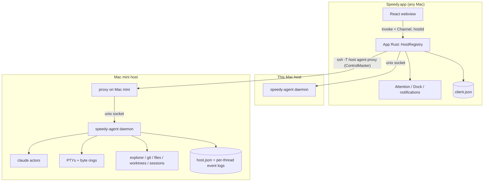
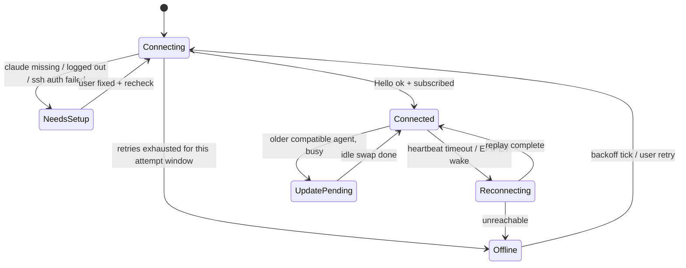
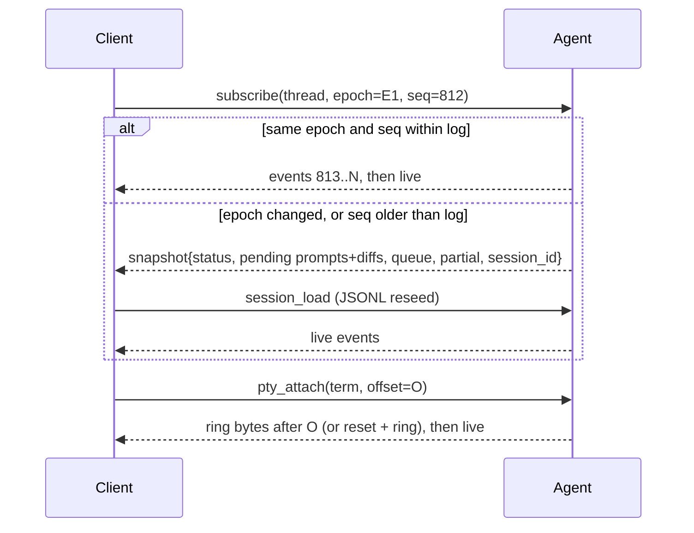

# Remote Hosts and speedy-agent - Plan

## Goal Capsule

- **Objective:** The user starts a thread, terminal or explorer session on any of their Macs (the always-on Mac mini, this laptop, or another Mac) from one Speedy window. They can close the laptop for hours and, when they come back, find the work finished, with the full transcript and prompts plus recent terminal output, as if the window had stayed open.
- **Means:** A headless `speedy-agent` runs on every host and owns all thread, terminal, file and git work. Speedy.app becomes a client that reaches each host's agent over the user's own SSH, or directly on This Mac, and replays what it missed on reconnect (KTD1, KTD2, KTD5).
- **Authority:** User request > Product Contract R-IDs > KTDs > unit Approach text. An R wins on product behavior, and a KTD wins on mechanism. This plan supersedes the desktop plan (`docs/plans/2026-10-14-2022-feat-speedy-claude-desktop-plan.md`) wherever the two conflict, as listed under System-Wide Impact.
- **Stop conditions:**
  - Stop and re-plan if the U1 spike shows that neither a `gui/<uid>` LaunchAgent nor a `CLAUDE_CODE_OAUTH_TOKEN` lets `claude` authenticate on the Mac mini without a live SSH session.
  - Stop if the CLI cannot resume a thread with `--resume` after the agent restarts, because KTD8 depends on it.
- **Execution profile:** Phased. U1 is a throwaway spike that gates U7. Milestone A (U2–U10) routes This Mac through the agent with no visible change. Milestone B (U11–U12) adds SSH hosts and the host UI.
- **Finishes and ships:** The user. It is a personal app built from source with `scripts/reinstall.sh`, so there is no distribution or signing pipeline.

---

## Product Contract

### Summary

Speedy gains hosts. Every project lives on exactly one host, and each host runs `speedy-agent`, which keeps threads, terminals and their history alive whether or not any Speedy window is connected. The app lists hosts from `~/.ssh/config`, installs and updates the agent over SSH, shows each host's connection state, and catches up on everything that happened while it was away. This Mac is a host like any other.

### Problem Frame

The user develops almost entirely on a Mac mini that is always on, and uses the laptop as a window into that work. Speedy today runs every `claude` process and shell inside the app on the laptop, so closing the lid pauses or kills the work. Using the mini means Screen Sharing or a separate Speedy install with no shared view. tmux over SSH keeps work alive but loses Speedy's UI, which is the reason Speedy exists.

The desktop plan made the app own every process and rejected a server-side event log, because a single local webview could always rebuild from its own store. Both assumptions break once the work runs on another machine and the client comes and goes.

### Requirements

**Hosts and connection**

- R1. The user adds a host by choosing an entry from `~/.ssh/config`. Speedy connects with the user's own SSH setup (keys, agent, ProxyJump, 1Password) and installs the agent with no manual steps on the host.
- R2. This Mac is always present as a host and reaches its agent without SSH.
- R3. Each host shows its own connection state (connecting, connected, reconnecting, offline, needs setup). A host that is offline or failing never blocks or degrades the others.
- R4. When the app has a newer agent than a host runs, the host is upgraded without killing threads or terminals that are working.
- R5. Each host shows its own setup state: `claude` missing, logged out, or unable to read its login. It names the fix, including `claude setup-token` when the host can't reach the Keychain.

**Work that outlives the client**

- R6. Threads, queued messages and terminals on a host keep running when no client is connected, for as long as the host stays awake.
- R7. On reconnect, the client shows everything it missed: transcript, thread status, pending permission prompts with their diffs, the queue, and recent terminal output.
- R8. A permission prompt waits until a client answers it, however long that takes.
- R9. Messages queued before the client disconnected are sent in order as the thread becomes idle, with no client attached.

**Several clients**

- R10. Several Speedy windows, on one machine or several, can view and drive the same thread. Any of them can send messages, edit the queue, interrupt, or answer a prompt.
- R11. When two clients answer the same prompt, only the first answer reaches `claude`, and every client sees the outcome.
- R12. A message sent from one client appears in every client's transcript, including after a replay.

**Projects and remote work**

- R13. Each project belongs to one host, and threads never move between hosts. The sidebar groups projects under their host. Groups, ordering and layout are the client's own.
- R14. Adding a project on a host uses a folder browser that lists that host's folders.
- R15. The explorer, git status and diff, `@` file search, permission diffs, worktrees, session history, rewind and the setup screen all operate on the thread's host.
- R16. Open in VS Code opens remote projects as VS Code remote windows. File links in the transcript and terminal open on the right host.

**Lifecycle and migration**

- R17. Quitting Speedy.app leaves This Mac's agent and its threads running. A menu item stops This Mac's agent on request, and quitting while threads are working says they will keep running.
- R18. The user's existing projects, threads, worktrees and Chats move to the This Mac host on first launch. Existing groups stay in the app, keyed to the This Mac host. Every thread can still resume its session.

### Key Decisions

- **One codebase, and This Mac is just another host.** It runs the same agent and the same code path. (session-settled: user-approved — chosen over forking Speedy into a separate remote-first app: two codebases would drift, and a local agent is how the agent gets developed and tested.) Governs R2, R13.
- **Hosts are independent.** Each has its own connection, projects and setup, and no thread crosses hosts. (session-settled: user-directed — the user specified independent hosts when describing the multi-host concept, over a shared or synced pool.) Governs R3, R13.
- **Hosts come from `~/.ssh/config`, and the app installs the agent over SSH.** (session-settled: user-approved — chosen over a hand-installed server reached over Tailscale with a token: zero setup on the host and no new credentials.) Governs R1, R4.
- **The host is the source of truth for its projects and threads.** The app stores only the host list and UI preferences. (session-settled: user-approved — chosen over app-held thread state: a second laptop sees the same threads.) Governs R10, R13.
- **Several clients may drive one thread at once.** (session-settled: user-approved — chosen over single-client locking.) Governs R10, R11, R12.
- **Prompts wait while the user is away, and permission modes are unchanged.** (session-settled: user-approved — chosen over auto-deny or phone approval.) Governs R8.
- **Quitting the app leaves This Mac's agent running.** (session-settled: user-directed — chosen over stopping local threads with the app, today's behavior.) Governs R17.
- **macOS hosts only.** (session-settled: user-directed — Linux builds and testing deferred.) The agent avoids gratuitous Mac-only assumptions so Linux stays cheap later.

### Success Criteria

- The laptop lid stays closed for three or more hours while a thread works on the Mac mini. After opening it, the transcript shows no gap, any pending prompt is answerable, and the terminal shows its recent output.
- After a Wi-Fi drop or `sshd` restart, the host shows as reconnecting within 30 seconds and catches up without user action.
- A day of work on the Mac mini needs no Screen Sharing or SSH terminal outside Speedy.

### Scope Boundaries

- Linux hosts: the agent stays portable where it costs nothing, but there are no Linux builds, CI or testing.
- No phone or push notifications for prompts that come up while the user is away.
- No moving a thread or project between hosts, and no syncing settings, MCP config or `claude` logins between hosts.
- No collaboration between different users. One user owns every host.
- Considered and not built: a server-side terminal emulator for exact screen snapshots. A byte ring plus reset is enough because TUIs redraw on resize. Revisit if replayed terminals look broken in practice.
- Considered and not built: an idle shutdown timer for the agent. An always-on host gains nothing from it, and stopping is available on request. Revisit if idle agents use noticeable memory.
- Considered and not built: a per-connection secret token on top of the socket's same-user check. The uid check is the real boundary, and SSH already authenticated the user (KTD12). Revisit if a sandboxed same-user process becomes a threat.
- Considered and not built: per-client terminal sizes. One PTY has one size, and following the latest typist matches tmux. Revisit if two windows on different screens fight.

#### Deferred to Follow-Up Work

- Linux agent builds (x86_64 and arm64), the `/bin/bash` fallback, and the VS Code settings path for Linux (`src-tauri/src/env.rs`).
- A host-level "needs you" summary notification channel to a phone.

---

## Planning Contract

### Key Technical Decisions

- KTD1. **Three crates in one Cargo workspace.** `speedy-core` holds everything Tauri-free: claude actors, PTYs, diff, explorer, files, worktrees, session index, env, the host store and the wire protocol. `speedy-agent` is the headless binary. The app crate keeps Tauri, AppKit and attention. The core modules already have no Tauri imports, so the move is mechanical. A second binary in today's crate would link Tauri and AppKit into the agent.
- KTD2. **System `/usr/bin/ssh`, carried over stdio to a unix socket.** The app runs one private ControlMaster per host (`ControlPersist=no`, ControlPath `~/.speedy/cm/%C` to stay under the 104-byte socket limit, `ServerAliveInterval=15`). It talks to the agent through `ssh -T <host> <agent> proxy`, which relays stdio to `~/.speedy/agent/state/agent.sock`. This Mac connects to the same socket directly. There is no TCP listener and no port forward. System ssh honors `~/.ssh/config`, ProxyJump and `IdentityAgent`, and russh does not. Passphrase and 2FA prompts go through an askpass helper to an app dialog.
- KTD3. **The webview never touches the network.** App Rust holds every host connection and keeps today's `invoke` and `Channel` surface, adding a host id. The CSP (`connect-src ipc:`) stays, and PTY bytes keep their binary path.
- KTD4. **Frames are length-prefixed binary with msgpack payloads.**
  - Each frame is a `u32` little-endian length, a kind byte, a stream id and the payload. Payloads are serde types encoded with `rmp-serde`, and PTY output is raw bytes.
  - The session opens with a magic preamble, so shell-rc noise before the agent starts is skipped, then a `Hello` both ways carrying the protocol range, capabilities, agent version, `host_id` and `epoch`.
  - Frames are capped at 16 MiB, and large file reads are chunked.
  - JSON lines are rejected because they would force base64 on every PTY chunk.
- KTD5. **Each thread has a replayable, append-only event log in the agent's memory.** This reverses the desktop plan's rejected event log.
  - The cursor is `(epoch, seq)`, where `epoch` changes every time the agent starts.
  - The log is a bounded in-memory buffer owned by the agent process. Partial `stream_event`s are dropped once their message completes, and each thread's buffer is capped at 64 MiB.
  - The log is not written to disk. Any agent restart changes the epoch, so a disk log would never be replayed. After a restart, the snapshot plus the session JSONL are the recovery path.
  - A subscribe with no cursor, a different epoch or a cursor older than the log returns a snapshot: status, pending prompts with diffs, the queue, in-flight partial text and session id. The client then reseeds history from the session JSONL as it does today.
  - Each PTY keeps a 2 MiB byte ring addressed by byte offset. A cursor older than the ring gets a reset plus the ring's contents.
- KTD6. **The host owns thread behavior and state.**
  - The agent persists projects, threads, session bindings, model and mode, worktree records, titles and the queue in a host store at `~/.speedy/agent/state/host.json`. It changes them only through fine-grained operations and broadcasts each change.
  - The client-only behaviors move into the agent: the queue and its flush, the `user_sent` echo (the CLI does not echo user messages), auto-title, worktree creation before the first start, the session binding, and creating rewind forks.
  - The client keeps `client.json` with groups, ordering, collapse, sidebar and split sizes, selection and notification prefs, keyed by `(host_id, project_id)`.
  - Whole-blob `state_save` is retired, because with two clients the last writer would erase the other's changes.
- KTD7. **Agent output fans out to every client, and a slow client never blocks the host.**
  - The `claude` stdout and PTY readers always drain into the log and ring. Each client has an 8 MiB outbound queue. A client that overflows it gets `Lagged` and catches up through KTD5 replay.
  - Permission answers are first-wins: the agent removes the pending request atomically before writing, and a losing answer gets an "already answered" result. `permission_resolved` and refreshed diffs go to every client, as does every resolution caused by stop or interrupt.
  - A PTY's size follows the client that most recently typed in it or focused it.
- KTD8. **The agent is a long-lived per-user daemon.**
  - A `flock` on `state/agent.lock` makes it a singleton. A `run` that loses the lock exits 0, so launchd's `KeepAlive` does not respawn it. Clients never kill the agent, and it has no idle timeout.
  - It runs as a LaunchAgent in `gui/<uid>` (`ProcessType=Interactive`, `KeepAlive` on crash), so `claude` can read the login Keychain. With no GUI session, detected by `launchctl managername`, it runs as a self-daemonized process and passes the token from a 0600 `state/claude-token` file to `claude` as `CLAUDE_CODE_OAUTH_TOKEN`.
  - The token reaches the host only through a `set_claude_token` RPC. The agent creates the file atomically with mode 0600 at open. The token never appears in `host.json`, events, snapshots, RPC results or logs, and setup state reports only whether one is present.
  - The token is set only on the `claude` child's environment, never in the shared resolved env that shells and git also use.
  - While any thread is Working it holds an in-process `PreventUserIdleSystemSleep` assertion.
  - When the agent restarts, threads come back Stopped with their session ids and queues, and the next send resumes with `--resume`. The desktop plan's KTD9 shutdown sequence (deny, interrupt, SIGTERM/SIGHUP, SIGKILL) now runs only when the agent itself stops.
- KTD9. **Upgrades are side by side and never kill work.**
  - The app ships a universal2 `speedy-agent`, re-signed ad hoc after `lipo` and `strip`. It uploads the binary to `~/.speedy/agent/bin/<version>-<sha8>/` over the ControlMaster, checks its sha256, then renames it into place and switches the `current` symlink.
  - A client works with agents at protocol N and N-1.
  - When the running agent is older but compatible and busy, the client keeps using it and shows "update pending". The swap happens once no thread is Working or awaiting an answer and no PTY has a foreground child.
  - An incompatible busy agent blocks only that host until it is idle or the user approves "restart now".
- KTD10. **Hosts are identified by an agent-generated `host_id`.** The agent creates a UUID on first start and keeps it in `state/host-id`. The client keys everything by `host_id` and treats the SSH alias as connection detail, so adding the same machine twice under two aliases merges into one host.
- KTD11. **This Mac's agent is independent of the app.** It is installed and started through the same LaunchAgent path from the bundled binary. The app's `ExitRequested` stops only client-side work. "Stop This Mac's Agent" sends the agent a shutdown request (R17, KTD8).
- KTD12. **The socket is locked to the host's own user.**
  - The socket directory is 0700, and every connection's peer uid must match the agent's uid. That check, plus SSH authentication, is the security boundary.
  - File RPCs have no project-root guard. Any connected client can already open a shell as the same user, so a guard would protect nothing. It would also break transcript links to files outside a project.
  - git runs with the resolved login env instead of the process PATH, which is minimal under launchd.
- KTD13. **Replayed state changes never notify.** Attention runs on the client, fed by `status` events. Transitions that arrive in a replay or snapshot update unread flags silently. Banners, sounds and the Dock badge fire only for transitions that happen while connected.
- KTD14. **The app's Rust side owns host connections.**
  - A `HostRegistry` keeps one connection task per host. Each task runs a connect, handshake, subscribe and heartbeat loop: ping every 5 s, dead after about 25 s of silence, and reconnect with backoff capped at 30 s.
  - On `NSWorkspaceDidWakeNotification` the app tears down every ControlMaster and reconnects, because masters that survived sleep often hang.
  - Each connection tracks the last `(epoch, seq)` per thread and byte offset per PTY at the transport layer. The reducer's existing `lastSeq` stays for its own use.
  - When a proxy exits with code 90 (no agent running), the client treats state as lost and does a fresh connect.

### High-Level Technical Design

**Components**



**Connect, bootstrap and upgrade (SSH host)**

```mermaid
sequenceDiagram
  participant App as App Rust
  participant SSH as ControlMaster
  participant Host as Mac mini
  App->>SSH: start master (askpass for prompts)
  App->>Host: probe (NUL-delimited: OS, $SHELL, $HOME, managername, current agent version)
  alt agent missing or older than app
    App->>Host: upload bin/<ver>-<sha8>, verify sha256, rename
  end
  App->>Host: speedy-agent proxy
  alt exit 90 (no daemon)
    Host->>Host: install/bootstrap LaunchAgent (gui/uid) or daemonize
    App->>Host: speedy-agent proxy (retry)
  end
  Host-->>App: preamble + Hello{protocol range, host_id, epoch}
  App->>Host: Hello; subscribe host + threads with (epoch, seq) cursors
  Host-->>App: replay or snapshot, then live events
  opt older compatible agent, busy
    App-->>App: show "update pending"; swap when the host is idle (KTD9)
  end
```

**Host connection state**



**Reconnect replay**



### Output Structure

```text
src-tauri/
  Cargo.toml                      # becomes workspace root + app package
  crates/
    speedy-core/src/
      claude/  pty/  state/       # moved from src-tauri/src
      diff.rs explorer.rs files.rs worktree.rs env.rs proc_group.rs
      host/                       # host store, event log, snapshot (U5)
      proto/                      # frames, Hello, messages (U4)
    speedy-agent/src/
      main.rs                     # run | proxy | version | install | stop
      server.rs clients.rs pty_ring.rs paths.rs launchd.rs power.rs daemonize.rs
  src/
    hosts/                        # HostRegistry, ssh, local, bootstrap (U8, U11)
scripts/build-agent.sh            # universal2 build + ad-hoc re-sign
```

### Assumptions

- The Mac mini normally has the user logged in at the console, so the `gui/<uid>` LaunchAgent path is the main one. U1 confirms this, and the token fallback covers the other case.
- Thread and project ids stay client-generated UUIDs, and the host accepts them as keys.

---

## Implementation Units

| U-ID | Title | Key files | Depends on |
|---|---|---|---|
| U1 | Mac mini launch and auth spike | `spike/remote-launch/` | none |
| U2 | Cargo workspace and Tauri-free core | `src-tauri/Cargo.toml`, `src-tauri/crates/speedy-core/` | none |
| U3 | First-wins permission answers | `crates/speedy-core/src/claude/actor.rs` | U2 |
| U4 | Wire protocol | `crates/speedy-core/src/proto/` | U2 |
| U5 | Host store and event log | `crates/speedy-core/src/host/` | U2, U3 |
| U6 | Agent daemon | `crates/speedy-agent/` | U4, U5 |
| U7 | Agent lifecycle on macOS | `crates/speedy-agent/src/launchd.rs`, `power.rs` | U1, U6 |
| U8 | App host registry and This Mac connection | `src-tauri/src/hosts/`, `src-tauri/src/lib.rs` | U4, U6, U7, U10 |
| U9 | Frontend host-aware transport and store split | `src/ipc/commands.ts`, `src/store/*` | U8 |
| U10 | Migrate existing state to This Mac | `crates/speedy-core/src/host/migrate.rs` | U5 |
| U11 | SSH hosts: bootstrap, connect, upgrade | `src-tauri/src/hosts/ssh.rs`, `bootstrap.rs` | U8, U10 |
| U12 | Host UI and remote affordances | `src/sidebar/*`, `src/settings/*`, `src/hosts/*` | U9, U11 |

### U1. Mac mini launch and auth spike

- **Goal:** Learn which agent launch mode lets `claude` authenticate on the real Mac mini, and whether a LaunchAgent can read protected folders.
- **Requirements:** R5, R6.
- **Dependencies:** none.
- **Files:** `spike/remote-launch/RESULTS.md`, plus throwaway scripts in `spike/remote-launch/`.
- **Approach:** On the Mac mini, run `claude -p hi` and `claude auth status` in each of these cases:
  1. From a plain SSH session.
  2. From a process detached with `setsid()` that outlives the SSH session.
  3. From a LaunchAgent started with `launchctl bootstrap gui/<uid>` over SSH.
  4. From the detached process with `CLAUDE_CODE_OAUTH_TOKEN` from `claude setup-token`.

  Also record:
  - `launchctl managername` in each case.
  - Whether the LaunchAgent can list `~/Documents` and `~/Desktop` (TCC).
  - Whether `claude --resume <id>` continues a session started by an earlier process.
- **Execution note:** Throwaway quality. Record results in `spike/remote-launch/RESULTS.md`, following `spike/RESULTS.md`.
- **Patterns to follow:** `spike/RESULTS.md`.
- **Test expectation:** none -- spike. The output is a results file that fixes U7's launch order.
- **Verification:** `RESULTS.md` states which mode U7 uses first, whether the token fallback works, and whether a Full Disk Access step is needed.

### U2. Cargo workspace and Tauri-free core

- **Goal:** Move every host-side module into `speedy-core` with no Tauri dependency. The app keeps working exactly as before.
- **Requirements:** R2, R15 (KTD1).
- **Dependencies:** none.
- **Files:**
  - Modify: `src-tauri/Cargo.toml` (workspace root), `src-tauri/src/lib.rs`, every command wrapper in `src-tauri/src/{claude,pty,state}/mod.rs`, `src-tauri/src/{env,explorer,files,worktree}.rs`.
  - Create: `src-tauri/crates/speedy-core/Cargo.toml`, `src-tauri/crates/speedy-core/src/lib.rs` and the moved modules.
  - Move: `src-tauri/tests/*.rs` and `src-tauri/tests/fixtures/` to `src-tauri/crates/speedy-core/tests/`.
- **Approach:**
  1. Create the workspace and the `speedy-core` crate, and move `claude/actor.rs`, `process.rs`, `protocol.rs`, `diff.rs`, `pty/manager.rs`, `pty/coalesce.rs`, `state/store.rs`, `state/session_index.rs`, `proc_group.rs`, `explorer.rs`, `files.rs`, `worktree.rs`, `env.rs` and the pure `AttentionState`.
  2. Replace `tauri::async_runtime::spawn_blocking` with `tokio::task::spawn_blocking`.
  3. Replace `PtyManager`'s `AppHandle` with an exit callback, and the actor's status observer stays a plain callback.
  4. Pass the resolved login env to git in `explorer.rs` and `worktree.rs` (KTD12).
  5. Leave each `#[tauri::command]` in the app crate as a thin wrapper over core.
- **Patterns to follow:** The existing core-plus-thin-wrapper split, for example `claude/actor.rs` and its wrappers in `claude/mod.rs`. Keep the module doc headers (`//! U3: … (KTD4)`).
- **Test scenarios:**
  - Every existing Rust test passes unchanged from its new crate, including the fake-claude actor tests and the zsh PTY tests.
  - `speedy-core` builds with no `tauri` or `objc2` in its dependency tree.
  - A git call from the explorer under a minimal PATH (only `/usr/bin:/bin`) finds git through the resolved env, if the login env provides one.
- **Verification:** The app behaves as before, and `cargo tree -p speedy-core` shows no Tauri crates.

### U3. First-wins permission answers

- **Goal:** Only one answer to a permission prompt ever reaches `claude`, and every resolution is announced as an event.
- **Requirements:** R11 (KTD7).
- **Dependencies:** U2.
- **Files:** Modify `src-tauri/crates/speedy-core/src/claude/actor.rs` and `src-tauri/crates/speedy-core/src/claude/mod.rs`. Test in `src-tauri/crates/speedy-core/tests/claude_actor_test.rs`.
- **Approach:**
  - In `respond_permission`, remove the pending entry under the lock and treat a missing entry as "already answered" before writing to the CLI. Today the code looks the entry up, releases the lock, then removes it without checking the result.
  - Emit `permission_resolved` with the outcome when an answer is sent.
  - Emit a refreshed-diff event instead of returning the diff only to the caller.
  - Make `stop` and `interrupt` emit a resolution for each prompt they clear.
- **Patterns to follow:** The existing `permission_resolved` emission and the `PermissionOutcome` shape.
- **Test scenarios:**
  - Two concurrent `respond_permission` calls, one allow and one deny, for the same request: fake-claude receives exactly one `control_response`, and the loser gets an "already answered" error.
  - An allow with a stale diff emits a refreshed-diff event and sends nothing. A second allow after the refresh sends once.
  - `stop` with two pending prompts emits two `permission_resolved` events before the child exits.
- **Verification:** The fake-claude log shows a single answer per request under concurrency.

### U4. Wire protocol

- **Goal:** One framing and message set shared by the agent and the app, covering RPC, host and thread subscriptions, and PTY streams.
- **Requirements:** R4, R7, R10 (KTD4, KTD5, KTD9).
- **Dependencies:** U2.
- **Files:** Create `src-tauri/crates/speedy-core/src/proto/{mod.rs,frame.rs,messages.rs}` and test `src-tauri/crates/speedy-core/tests/proto_test.rs`. Add `rmp-serde` to `speedy-core`.
- **Approach:**
  - Frame codec per KTD4, with the preamble scanner and the 16 MiB cap.
  - `Hello` negotiation picks `min(max_a, max_b)` and fails cleanly when the ranges don't overlap.
  - Messages:
    - **RPCs:** every existing host-side command, with the same names and payloads plus correlation ids, the new host-store operations from U5, and `set_claude_token` (KTD8).
    - **Host stream:** `host_snapshot`, `thread_upserted`, `thread_removed`, `project_upserted`, and thread status.
    - **Thread stream:** every `ClaudeEvent` plus `user_sent`, `queue_changed`, `permission_resolved{by}`, `diff_refreshed` and `snapshot`.
    - **PTY stream:** `pty_data` with byte offset, `pty_reset` and `pty_exit`.
    - **Control:** `ping`/`pong`, `lagged`, and `shutdown`.
  - Every event carries `(epoch, seq)`.
- **Patterns to follow:** The existing serde conventions in `claude/mod.rs`: `ClaudeEvent` stays snake_case-tagged, and structs use camelCase.
- **Test scenarios:**
  - Round-trip every message type through encode and decode.
  - A preamble preceded by 3 KB of shell noise is found, and the noise is discarded.
  - A frame header claiming 32 MiB is rejected without allocating it.
  - A truncated frame at end of stream reports an error, not a panic.
  - Hello with ranges [3,4] and [4,5] picks 4. Ranges [2,3] and [4,5] return an incompatible-version error with both ranges.
- **Verification:** The protocol tests pass, and the app and agent both compile against the same `proto` types.

### U5. Host store and event log

- **Goal:** The host owns projects, threads and their behavior, and every thread's events can be replayed from a cursor.
- **Requirements:** R6, R7, R9, R10, R12 (KTD5, KTD6).
- **Dependencies:** U2, U3.
- **Files:**
  - Create: `src-tauri/crates/speedy-core/src/host/{mod.rs,store.rs,log.rs,thread.rs,snapshot.rs}`.
  - Modify: `src-tauri/crates/speedy-core/src/claude/actor.rs`, so `Inner::send` fans out to a subscriber list instead of one sink.
  - Tests: `src-tauri/crates/speedy-core/tests/host_store_test.rs`, `src-tauri/crates/speedy-core/tests/event_log_test.rs`.
- **Approach:**
  - **Host store.** Persist the host-owned fields from today's `AppState` (projects, threads, session id, model, mode, worktree, title, archive flag, `claude_path_override`) to `host.json` with the existing debounced atomic writer from `state/store.rs`. Changes go through fine-grained operations that broadcast.
  - **Host thread.** Wraps a `ClaudeActor` and does what the client does today in `src/store/runtime.ts`:
    - holds the FIFO queue and flushes it on idle or `result`;
    - emits `user_sent` before writing to stdin;
    - sets the auto-title from the first message;
    - records `session_bound`;
    - creates the worktree before the first start;
    - creates rewind forks.
  - **Event log.** Appends every emitted event to the in-memory log with `(epoch, seq)`, compacts partials, and serves `after(cursor)` or a snapshot per KTD5.
- **Patterns to follow:** `state/store.rs` (debounced atomic writes, corrupt-file notice), `src/store/runtime.ts` (queue, title and worktree logic being ported), and the fake-claude harness.
- **Test scenarios:**
  - Queue three messages while Working with no subscriber. Each is sent in order after each `result`, and each emits `queue_changed` and `user_sent`.
  - Subscribe with the current epoch and seq 10 after 25 events: events 11–25 arrive in order, then live events.
  - Subscribe with an old epoch: a snapshot arrives with status, pending prompts with diffs, the queue and the session id.
  - A cursor older than the log's compacted head gets a snapshot.
  - After a message completes, its partial `stream_event`s are gone from the log, and the completed `assistant` message remains.
  - Two subscribers both receive every live event, and dropping one does not affect the other.
  - Restart the store from disk: threads come back Stopped with their session id and queue intact.
  - The first send to a thread created with a worktree request creates the worktree, records it, then spawns `claude` in it.
- **Verification:** A fake-claude thread runs a queued conversation with no subscriber attached, and a late subscriber rebuilds the same transcript from the log.

### U6. Agent daemon

- **Goal:** A headless `speedy-agent` that serves several clients over a unix socket and keeps threads and PTYs alive between clients.
- **Requirements:** R6, R7, R10, R15 (KTD2, KTD7, KTD10, KTD12).
- **Dependencies:** U4, U5.
- **Files:**
  - Create: `src-tauri/crates/speedy-agent/Cargo.toml` and `src-tauri/crates/speedy-agent/src/{main.rs,server.rs,clients.rs,pty_ring.rs,paths.rs}`.
  - Tests: `src-tauri/crates/speedy-agent/tests/agent_test.rs`, which drives an in-process agent over a socket pair with fake-claude.
- **Approach:**
  - **Subcommands:**
    - `run` takes the `flock`, binds `state/agent.sock` inside a 0700 dir, writes `host-id` and a fresh epoch, and serves.
    - `proxy` relays stdio to the socket, and exits 90 when no daemon holds the lock.
    - `version --json` prints the version, protocol range and build sha.
    - `stop` sends a shutdown request.
  - **Client tasks:** each client gets a task with a bounded byte queue and `Lagged` on overflow, a peer-uid check on accept, and a 60 s silent-client timeout.
  - **PTY ring:** per-PTY ring buffer and offsets. The coalescer sink writes to the ring and fans out, never blocking the reader.
  - **Shutdown:** runs the desktop plan's KTD9 sequence over every actor and PTY.
- **Patterns to follow:** `pty/manager.rs` and `pty/coalesce.rs` for the reader-to-coalescer pipeline, and `claude/mod.rs::SessionManager` for actor ownership.
- **Test scenarios:**
  - Two clients attach to one thread. Client A sends a message, and both see `user_sent` and the reply.
  - A client that stops reading gets `Lagged` after 8 MiB of PTY output, while the other client and the shell keep flowing.
  - The client disconnects mid-turn. The turn completes, and a new client replays the rest from its cursor.
  - A second `run` while one holds the lock exits 0 without touching the socket.
  - `proxy` with no daemon exits with code 90.
  - A connection from a different uid is refused. Exercise this by injecting the peer-cred check.
  - A PTY attach with an offset inside the ring gets exactly the bytes after it. An offset before the ring gets `pty_reset` plus the ring's contents.
  - `stop` with a Working thread denies its prompts, interrupts it and exits within the desktop plan's KTD9 grace period.
- **Verification:** The agent runs from a terminal on This Mac, and two `proxy` sessions drive the same fake-claude thread.

### U7. Agent lifecycle on macOS

- **Goal:** The agent starts in the context where `claude` can log in, survives SSH disconnects and crashes, and keeps the host awake while working.
- **Requirements:** R5, R6, R17 (KTD8, KTD11).
- **Dependencies:** U1, U6.
- **Files:**
  - Create: `src-tauri/crates/speedy-agent/src/{launchd.rs,power.rs,daemonize.rs}`.
  - Modify: `src-tauri/crates/speedy-agent/src/main.rs` (`install` subcommand), `src-tauri/crates/speedy-core/src/env.rs` (token env and setup state).
  - Test: `src-tauri/crates/speedy-agent/tests/lifecycle_test.rs`.
- **Approach:**
  - **`install`:** writes `~/Library/LaunchAgents/dev.brecht.speedy.agent.plist` pointing at `bin/current`, then bootstraps and kickstarts it in `gui/<uid>`.
  - **Fallback:** used when the domain is unavailable (`managername` is not Aqua) or when U1 found it needed. `daemonize.rs` forks, calls `setsid()`, and sends stdio to `/dev/null`.
  - **Token and setup:** the actor's spawn path reads `state/claude-token` and sets `CLAUDE_CODE_OAUTH_TOKEN` on the `claude` child only (KTD8). `set_claude_token` writes the file. The setup state reports the launch domain, so the UI can explain a Keychain failure.
  - **Power:** `power.rs` holds an IOKit idle-sleep assertion while any thread is Working.
  - **Logs:** go to `~/Library/Logs/speedy-agent/` with size rotation.
- **Execution note:** Follow the launch order U1 settled. If U1 showed protected folders are blocked, add a setup message for Full Disk Access rather than code.
- **Patterns to follow:** The objc2 usage in `src-tauri/src/attention.rs` for macOS FFI. Use `libc` for `setsid` and `flock`.
- **Test scenarios:**
  - The generated plist has `ProcessType=Interactive`, `KeepAlive` on unsuccessful exit, and `ProgramArguments` pointing at `bin/current/speedy-agent run`.
  - With a token file present, the spawned fake-claude env contains `CLAUDE_CODE_OAUTH_TOKEN`, and a PTY shell's env and the git env do not. Without one, none of them do.
  - `set_claude_token` creates the file with mode 0600, and the next `host_snapshot` and agent log contain no token text.
  - With a daemonized agent holding the lock, starting the LaunchAgent exits 0 and is not respawned.
  - The sleep assertion is taken when a thread goes Working and released when it goes Idle, using an injected power backend.
  - Setup state reports the domain (`Aqua` or `Background`) next to NotLoggedIn.
- **Verification:** On the Mac mini, the agent installed over SSH keeps a thread running after the SSH session ends, and `claude auth status` reports logged in from inside it.

### U8. App host registry and This Mac connection

- **Goal:** The app talks to This Mac's agent instead of owning processes, with no visible change to the user.
- **Requirements:** R2, R3, R7, R17 (KTD3, KTD11, KTD14).
- **Dependencies:** U4, U6, U7, U10.
- **Files:**
  - Create: `src-tauri/src/hosts/{mod.rs,registry.rs,connection.rs,local.rs}`.
  - Modify: `src-tauri/src/lib.rs`, `src-tauri/src/claude/mod.rs`, `src-tauri/src/pty/mod.rs`, `src-tauri/src/state/mod.rs`, `src-tauri/src/menu.rs`, `src-tauri/tauri.conf.json` (bundle the agent binary), `scripts/reinstall.sh`.
  - Create: `scripts/build-agent.sh`.
  - Tests: `src-tauri/tests/hosts_test.rs`.
- **Approach:**
  - **Registry:** `HostRegistry` keeps one connection task per host, running the KTD14 loop.
  - **This Mac:** on launch the app stages the bundled binary under `bin/<version>-<sha8>/` and applies the KTD9 rules before running `install`. A compatible busy agent keeps running with "update pending" and is swapped when idle. An incompatible busy agent blocks This Mac until idle or "restart now". With no agent installed or an idle one, it installs and connects.
  - **Windows:** a "New Window" menu item opens another webview window in the same app process. Each window has its own thread and PTY Channel subscriptions, forwarded from the host's single connection, and `client.json` stays owned by the one process.
  - **Commands:** every host-side Tauri command takes a `hostId` and forwards over the connection. Thread and PTY subscriptions forward into the existing `Channel`s.
  - **Cursors:** the connection stores per-thread `(epoch, seq)` and per-PTY offsets, and resubscribes after reconnect.
  - **Attention and quit:** attention is fed from `status` events with replay suppressed (KTD13). `ExitRequested` no longer shuts down sessions or PTYs.
  - **Menu:** add "Stop This Mac's Agent".
  - **Build:** `build-agent.sh` builds arm64 and x86_64, runs `lipo`, re-signs ad hoc, and drops the binary where Tauri bundles it.
- **Patterns to follow:** `claude/mod.rs::SessionManager::sink` for Channel forwarding, and `pty/mod.rs` for raw `InvokeResponseBody` delivery.
- **Test scenarios:**
  - Against an in-process agent: `claude_start` plus `send_user` through the registry produce the same Channel events as today's direct path.
  - Kill the connection mid-turn and reconnect. The Channel receives the missed events once, in order, with no duplicates.
  - A replayed `status` transition to Idle does not fire a notification effect, and a live one does.
  - App `ExitRequested` leaves the agent's actors running.
  - The installed agent version matches the bundle: `install` is skipped.
  - The bundle is newer and a local thread is Working: `install` is deferred, the actor keeps running, and This Mac shows "update pending".
  - Two windows subscribe to the same thread and both receive every event.
- **Verification:** Daily use on This Mac feels unchanged. Quitting and relaunching the app mid-turn shows the turn still running.

### U9. Frontend host-aware transport and store split

- **Goal:** The webview addresses every call to a host, and its stores become a cache of host state plus client-only prefs.
- **Requirements:** R9, R10, R12, R13 (KTD6, KTD13).
- **Dependencies:** U8.
- **Files:**
  - Modify: `src/ipc/commands.ts`, `src/ipc/types.ts`, `src/store/appStore.ts`, `src/store/runtime.ts`, `src/store/reducer.ts`, `src/store/threadStore.ts`, `src/terminal/registry.ts`, `src/terminal/tabs.ts`, `src/composer/SlashMenu.tsx`, `src/app/testing/tauriMock.ts`, and the 19 modules importing `ipc/commands`.
  - Tests: `src/store/appStore.test.ts`, `src/store/runtime.test.ts`, `src/store/reducer.test.ts`, `src/ipc/commands.test.ts`.
- **Approach:**
  - **Routing:** wrappers derive `hostId` from a project and thread index, so callers keep passing `threadId` or `projectId`. Path-keyed calls take the project.
  - **Host data:** `useAppStore` splits into host data (filled from host snapshots and upserts, mutated only through host RPCs) and client prefs (saved to `client.json`).
  - **Behavior removed from the client:** `runtime.ts` loses the client queue, flush, auto-title, worktree prep and session binding, and renders the host's `queue_changed` and `user_sent` instead. The optimistic `local_user` bubble is reconciled with the first matching `user_sent`.
  - **Terminals:** terminal tabs come from the host's PTY list.
  - **Cache keys:** the SlashMenu cache is keyed by host.
  - **Test mock:** `tauriMock` gains a per-host backend map.
- **Patterns to follow:** The existing reducer action style and rAF batching in `threadStore.ts`.
- **Test scenarios:**
  - Send while Working: the item appears from `queue_changed`, and nothing is held in client state.
  - A `user_sent` arriving for a message typed in another client renders a user bubble. The client's own optimistic bubble is not duplicated.
  - A host snapshot replaces that host's projects and threads, and another host's entries are untouched.
  - Group membership keyed by `(hostId, projectId)` survives a host going offline and coming back.
  - A `permission_resolved{by: other}` removes the prompt card in this client.
  - Two hosts with the same project path stay separate projects.
- **Verification:** `bun run test` and `bun run typecheck` pass, and two app windows on This Mac show the same thread live.

### U10. Migrate existing state to This Mac

- **Goal:** The first launch after the upgrade moves today's projects and threads to the This Mac host without losing resume, worktrees or Chats.
- **Requirements:** R18 (KTD6).
- **Dependencies:** U5.
- **Files:** Create `src-tauri/crates/speedy-core/src/host/migrate.rs` and test `src-tauri/crates/speedy-core/tests/migrate_test.rs`. Modify `src-tauri/crates/speedy-agent/src/main.rs` (`run`) and `src-tauri/src/state/mod.rs`.
- **Approach:**
  - The agent runs the host half inside `run`, after taking the lock and before loading the store or binding the socket. When `host.json` is absent and `~/Library/Application Support/Speedy/state.json` exists, it writes the host fields per KTD6 to `host.json`, so a running agent's empty store can never overwrite them.
  - The app runs the client half, writing the client fields to `client.json`. Each half writes its own marker.
  - Keep the absolute Chats and worktree paths as recorded, and keep the agent's default Chats and worktree bases at the existing `Speedy/` paths on every host.
  - Write a migration marker, and leave `state.json` in place untouched.
- **Patterns to follow:** The `LoadResult.notice` corrupt-file handling in `state/store.rs`.
- **Test scenarios:**
  - A fixture `state.json` with groups, two projects, a worktree thread, a Chats thread and an archived thread migrates field for field. Session ids and worktree paths are unchanged.
  - Running the migration twice does nothing the second time.
  - The agent starts with `state.json` present and no `host.json`, and its first `host_snapshot` contains the migrated projects and threads.
  - A corrupt `state.json` produces an empty host plus a notice, and the original is preserved.
- **Verification:** After upgrading, every old thread resumes and the worktree thread still opens its worktree.

### U11. SSH hosts: bootstrap, connect, upgrade

- **Goal:** Adding a host from `~/.ssh/config` connects, installs or upgrades the agent, and reconnects across sleep with no manual steps.
- **Requirements:** R1, R3, R4, R5 (KTD2, KTD9, KTD10, KTD14).
- **Dependencies:** U8, U10.
- **Files:**
  - Create: `src-tauri/src/hosts/{ssh.rs,ssh_config.rs,bootstrap.rs,askpass.rs,wake.rs}`.
  - Tests: `src-tauri/tests/ssh_config_test.rs`, `src-tauri/tests/bootstrap_test.rs`.
- **Approach:**
  - **Host list:** `ssh_config.rs` lists concrete `Host` aliases from `~/.ssh/config` and its `Include`s. Each alias is resolved with `ssh -G`.
  - **ssh.rs:**
    - owns the private ControlMaster per KTD2, starting it with `kill_on_drop`;
    - runs every command with `ControlMaster=no`;
    - wires `SSH_ASKPASS` to `askpass.rs` with `SSH_ASKPASS_REQUIRE=force`, which raises a Tauri dialog. The helper reaches the app over a socket in a 0700 dir under `~/.speedy/`, authenticated by a per-invocation nonce in its env, and answers are never logged or reused.
    - A cancelled prompt puts the host in Needs setup instead of retrying. Background reconnects never raise a prompt unprompted: when the master needs input on a wake reconnect, the host shows Needs setup with a Reconnect button that raises it.
  - **bootstrap.rs:**
    - runs the NUL-delimited probe;
    - compares `version --json`;
    - uploads, verifies sha256 and renames into place;
    - runs `install`;
    - keeps the newest two version dirs.
    - When the agent is busy, it applies the KTD9 deferral and N-1 rule.
  - **wake.rs:** subscribes to `NSWorkspaceDidWakeNotification` and makes the registry drop every master and reconnect.
  - **Duplicates:** a host whose `Hello.host_id` matches a known host merges into it (KTD10).
- **Patterns to follow:** `env.rs`'s login-shell capture for timeouts and process-group kills on child processes.
- **Test scenarios:**
  - An ssh config with `Host *`, `Host mini`, `Include` and a wildcard pattern lists only concrete aliases.
  - Probe output preceded by motd noise parses correctly.
  - The installed version equals the app's: no upload. Older and idle: upload, verify, swap. Older, compatible and busy: no swap, and the host reports "update pending". Older, incompatible and busy: the host is blocked with a restart prompt.
  - An upload whose sha256 mismatches is discarded, and `current` is unchanged.
  - Proxy exit 90 leads to `install` and one retry. A second 90 sends the host to NeedsSetup with the agent log tail.
  - A wake notification tears down masters, and the registry reconnects and resubscribes from stored cursors.
  - A second alias for the same machine resolves to the existing `host_id` and does not create a second host.
- **Verification:** On the real Mac mini: add the host, start a thread, close the lid for an hour, then reopen. The thread finished, and the transcript has no gaps.

### U12. Host UI and remote affordances

- **Goal:** The user manages hosts, sees each host's state, adds remote projects, and opens remote files and VS Code windows.
- **Requirements:** R3, R5, R13, R14, R16, R17.
- **Dependencies:** U9, U11.
- **Files:**
  - Modify: `src/sidebar/Sidebar.tsx`, `src/sidebar/SectionHeader.tsx`, `src/sidebar/ContextMenu.tsx`, `src/settings/SettingsDialog.tsx`, `src/app/SetupScreen.tsx`, `src/app/actions.ts`, `src/chat/markdown/Markdown.tsx`, `src/explorer/Explorer.tsx`, `src-tauri/src/lib.rs` (`open_in_vscode`, `open_path`).
  - Create: `src/hosts/{HostsSettings.tsx,FolderBrowser.tsx,HostHeader.tsx}`.
  - Tests: `src/sidebar/Sidebar.test.tsx`, `src/settings/SettingsDialog.test.tsx`, `src/hosts/FolderBrowser.test.tsx`.
- **Approach:**
  - **Settings:** a Hosts section lists ssh aliases to add, shows connected hosts with their state, and offers remove and retry.
  - **Sidebar:** hosts are the top-level sections, This Mac first. Each host section holds that host's own Chats block, then its groups, then ungrouped projects, matching today's order inside one host. A group belongs to one host.
  - **Status header:** each host header shows a text label for its state (Connecting, Reconnecting, Offline, Needs setup, Update pending), not only a color, plus a context menu with Retry, Restart agent now (shown for KTD9's blocked case), and Remove. An offline host shows its header with the last known project names from `client.json` and no threads.
  - **Disconnected threads:** while a thread's host is not Connected, the transcript stays readable from the last received state. The composer, prompt cards and terminal input are disabled with a one-line banner naming the host state. Everything re-enables after replay completes.
  - **Setup:** the setup screen becomes per host. When the host can't reach the Keychain, it shows the `claude setup-token` instructions from R5 and a field that sends the token through `set_claude_token`.
  - **Adding projects:** "Add Project" on a remote host opens `FolderBrowser`, which uses the host's directory listing. It starts in the host's `$HOME`, accepts a typed path, shows loading and error states, lists only directories, and supports arrow keys and Enter. This Mac keeps the native picker.
  - **Adding hosts:** choosing an alias shows each bootstrap step (connecting, checking, uploading, starting) inline. A failure names the step and the error: host key, auth, not macOS, or agent log tail. An alias that resolves to a known host says it was merged.
  - **Prompt conflicts:** when another client answers a prompt first, this client's card is replaced by the outcome ("Allowed in another window"), and an answer it sent too late gets the same text instead of an error.
  - **Local-only actions:** actions that only work on local paths (Reveal in Finder, `open -t`) are hidden for remote projects.
  - **Open in VS Code:** builds `vscode://vscode-remote/ssh-remote+<alias><path>` for remote hosts.
  - **File links:** a remote file link opens in the explorer on that host instead of calling `open -t`.
  - **Quit:** quitting while This Mac threads are working shows a one-line notice in the quit confirmation that they keep running.
  - **Stop This Mac's Agent:** confirms first when threads are working, then shows This Mac as Offline with a Start action.
- **Patterns to follow:** The existing sidebar section and context-menu submenus, and `SettingsDialog` sections.
- **Test scenarios:**
  - The sidebar renders two hosts. One goes offline: its header shows Offline, and the other host's threads stay interactive.
  - Adding a project from `FolderBrowser` on host B creates it on host B only.
  - Open in VS Code on a remote project builds the remote URI with the alias and absolute path.
  - Clicking `src/app.ts:42` in a remote thread reveals it in that host's explorer.
  - The setup screen for a host reporting NotLoggedIn in the Background domain shows the `claude setup-token` guidance and token field.
  - While a host is Reconnecting, its open thread's composer is disabled with the banner, and it re-enables after replay.
  - A prompt answered in another client shows the outcome text in this client's card.
- **Verification:** The full flow works on the real Mac mini: add host, add project, thread, terminal, explorer, VS Code.

---

## System-Wide Impact

- **Desktop plan decisions this supersedes:**
  - KTD6's single `state.json` becomes `host.json` plus `client.json` (KTD6 here).
  - KTD9's "quit = kill" becomes agent-stop only (KTD8, KTD11).
  - The rejected per-thread event log is reversed (KTD5).
  - "Shell processes aren't restored across app relaunch" no longer holds for app relaunch, because shells live in the agent. It still holds across agent restarts.
- **Process ownership:** Every `claude` and shell process moves from the app to the agent. Crashing or quitting the app no longer affects work. If the agent crashes, its children exit (stdin and PTY close) and come back Stopped and resumable.
- **Security boundary:** Remote hosts now accept file, git and process operations from the client. KTD12 limits them to the host's own user, authenticated by SSH.
- **Resource use on hosts:** In-memory event logs (capped at 64 MiB per thread) and agent version dirs on disk (newest two kept).

## Risks & Dependencies

| Risk | Mitigation |
|---|---|
| `claude` cannot read the Keychain from the agent's launch context. | U1 spike first, LaunchAgent in `gui/<uid>`, token fallback, and the setup screen names the domain (KTD8, R5). |
| TCC blocks a LaunchAgent from reading `~/Documents` or `~/Desktop` on the host. | U1 checks it. If it does, setup guides the user through a one-time Full Disk Access grant. |
| ControlMaster hangs after the laptop sleeps. | Tear down on wake, `ControlPersist=no`, `ServerAliveInterval` (KTD2, KTD14). |
| A release `strip` breaks the agent's ad-hoc signature, and arm64 refuses to run it. | `build-agent.sh` re-signs after `lipo` and `strip`. U11 tests the installed binary with `version --json` before swapping. |
| An upgrade kills running work. | Side-by-side install, N-1 compatibility, idle-only swap (KTD9). |
| CLI flag drift between hosts on different `claude` versions. | Setup state and the version-skew warning are per host. The existing drift test runs against each host's CLI. |

## Sources & Research

- Repo research: `src-tauri/src/claude/actor.rs` (single sink at `rebind`, fan-out point at `Inner::send`, the `respond_permission` race), `src/store/runtime.ts` (client-only queue, title, worktree and session binding), `src-tauri/tauri.conf.json` (CSP), `src-tauri/src/state/store.rs` (mixed host and client fields), `src-tauri/src/lib.rs` (quit kills all).
- Zed remote server design: `crates/remote_server/src/server.rs` and `crates/remote/src/remote_client.rs` (proxy subcommand, exit code 90, heartbeat 5 s × 5, length-prefixed frames). Its single-client, 10-minute idle model is rejected (zed-industries/zed#60413).
- Keychain from SSH and LaunchAgents: anthropics/claude-code#29816, and Apple DTS forum thread 765060 (bootstrap into `gui/<uid>`).
- russh's limited `~/.ssh/config` support: eugeny/russh#284.
- OpenSSH ControlMaster hang after sleep and `ControlPersist` races: openssh-bugs 3243 and 2420.
- tmux control-mode flow control (`pause-after`), the model for `Lagged`.

---

## Verification Contract

| Gate | Command or check | Applies to |
|---|---|---|
| Rust tests | `cargo test --manifest-path src-tauri/Cargo.toml --workspace` | U2–U8, U10, U11 |
| Rust lint | `cargo clippy --manifest-path src-tauri/Cargo.toml --workspace --all-targets -- -D warnings` | U2–U8, U10, U11 |
| Frontend tests | `bun run test` | U9, U12 |
| Types | `bun run typecheck` | U9, U12 |
| Core purity | `cargo tree -p speedy-core` shows no `tauri` or `objc2` | U2 |
| Build | `./scripts/reinstall.sh` produces an app with a universal2 `speedy-agent` that runs `version --json` | U8 |
| Real-host check | The Success Criteria scenarios on the Mac mini | U7, U11, U12 |

## Definition of Done

- Every R-ID is met, and the three Success Criteria pass on the real Mac mini.
- This Mac works as before, with threads surviving app quit.
- Existing threads resume after migration.
- All gates in the Verification Contract pass.
- The U1 spike results are recorded in `spike/remote-launch/RESULTS.md`, and nothing from the spike ships in production code.
- No dead code from abandoned approaches remains in the diff. The old whole-blob `state_save` path and the client-side queue, title and worktree logic are removed, not left dormant.
- The README explains hosts, how to add a host, the token fallback, and that This Mac's agent outlives the app.
